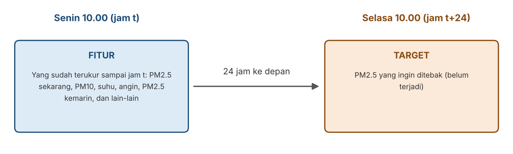
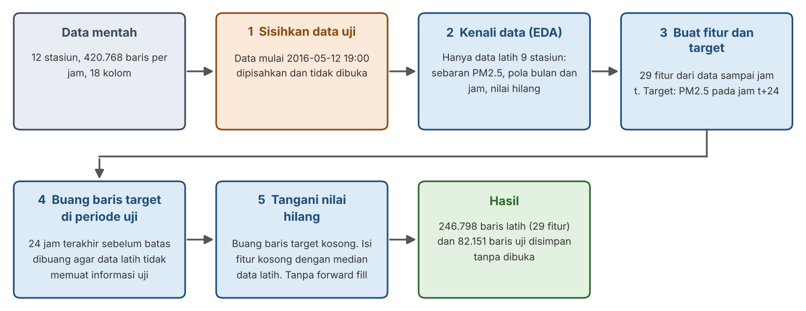
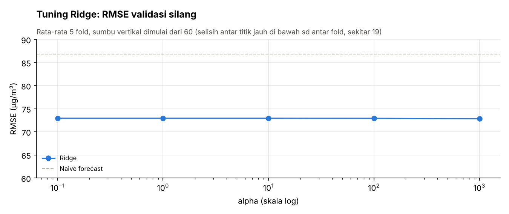
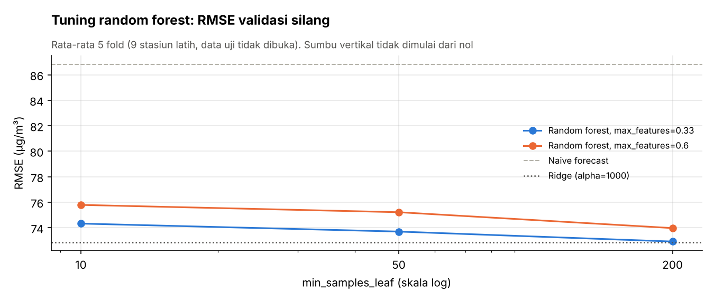
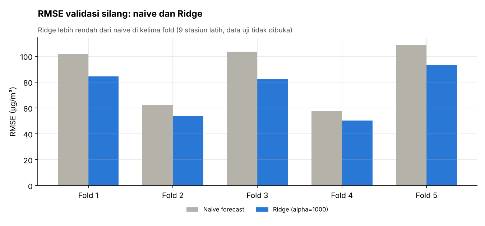
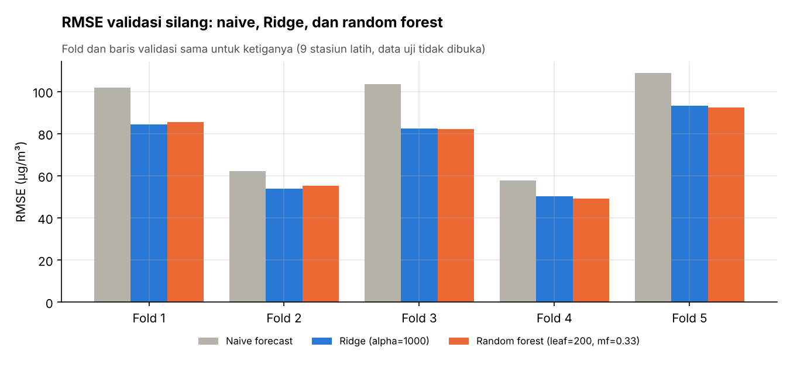

# Penjelasan Proyek dan Alur Tahapan

Ringkasan versi mudah dibaca. Angka diambil dari hasil eksekusi *notebook* pada data latih. Data uji belum pernah dibuka.

Proyek ini memprediksi konsentrasi PM2.5 di Beijing 24 jam ke depan (regresi deret waktu) dengan dataset Beijing Multi-Site Air Quality dari UCI (12 stasiun, data per jam, Maret 2013 sampai Februari 2017). Model dilatih pada 9 stasiun dan diuji pada 20% periode terakhir, termasuk 3 stasiun yang tidak pernah dilihat saat pelatihan (Dingling, Wanliu, Shunyi). Metrik utama RMSE, dengan MAE sebagai pendamping. Tiga tantangan dari dosen: nilai hilang pada sensor, validasi berurutan waktu, dan uji di stasiun lain (pergeseran distribusi). Yang dinilai bukan skor tertinggi, melainkan evaluasi yang benar dan bebas kebocoran data. Alurnya tujuh tahap, dijelaskan di bawah.

## Tahap 1. Rumusan masalah dan metrik

Tahap 1 dikerjakan sebelum membuka data. Panduan meminta tiga pertanyaan dijawab tertulis (siapa pemakainya, keputusan apa yang diambil, kesalahan mana yang paling merugikan). Di sini ditambah dua baris: apa yang diprediksi dan bagaimana mengukurnya.

| Pertanyaan | Jawaban di proyek ini |
|---|---|
| Apa yang diprediksi? | PM2.5 pada 24 jam ke depan (jam t+24) di stasiun pemantau Beijing. Model dilatih dari 9 stasiun dan dicoba di 3 stasiun uji untuk melihat apakah berlaku di tempat lain |
| Untuk siapa? | Warga dan otoritas kesehatan lingkungan |
| Keputusan apa yang diambil dari prediksi? | Membatasi paparan, misalnya aktivitas di luar ruangan dan pemakaian masker |
| Kesalahan mana yang paling merugikan? | Galat besar, terutama prediksi yang terlalu rendah saat polusi tinggi |
| Bagaimana mengukurnya? | **RMSE** sebagai metrik utama, karena menghukum galat besar lebih berat. MAE sebagai pendamping |

## Tahap 2. Eksplorasi dan praproses

**Tujuan:** mengubah data mentah menjadi tabel latihan yang siap dibaca model. Setiap baris tabel berisi dua hal: **fitur** (yang sudah diketahui) dan **target** (yang harus ditebak).

**Contoh satu baris.** Anggap sekarang Senin pukul 10.00 (disebut jam t).

- Fitur: semua yang sudah terukur sampai saat ini, misalnya PM2.5 pagi ini, PM10, suhu, angin, dan PM2.5 kemarin.
- Target: PM2.5 pada Selasa pukul 10.00 (jam t+24), yang belum terjadi.

Model belajar dari banyak baris seperti ini: dari fitur pada jam t, tebak target 24 jam kemudian.

**Aturan terpenting: fitur tidak boleh memakai data sesudah jam t.** Saat prediksi dibuat di dunia nyata, data sesudah jam t memang belum ada. Jika sebuah fitur memakainya, skor model terlihat bagus tetapi model itu tidak bisa dipakai sungguhan. Hal ini disebut *kebocoran data*.

### Isi tabel: 29 fitur

| Kelompok | Isi | Jumlah | Mengapa dipakai |
|---|---|---|---|
| Kondisi pada jam t | PM2.5, PM10, SO2, NO2, CO, O3, suhu, tekanan, titik embun, hujan, kecepatan angin | 11 | Keadaan udara dan cuaca saat ini |
| Riwayat PM2.5 (*lag*) | PM2.5 pada 1, 2, 3, 6, 12, 24, dan 48 jam sebelum jam t | 7 | PM2.5 cenderung mirip dengan beberapa jam atau hari sebelumnya |
| *Rolling mean* | rata-rata PM2.5 selama 6, 24, dan 72 jam terakhir (jam t ikut dihitung, jam sesudahnya tidak) | 3 | Gambaran tren jangka pendek sampai menengah |
| Arah angin | diubah menjadi sinus dan kosinus | 2 | Arah berbentuk lingkaran (0 derajat sama dengan 360 derajat), jadi dipecah menjadi dua angka agar nilai yang berdekatan tetap tampak dekat |
| Kalender | jam, hari, dan bulan, masing-masing sebagai sinus dan kosinus | 6 | Pola yang berulang. Dengan sinus dan kosinus, pukul 23.00 tercatat dekat dengan pukul 00.00 |

Fitur yang sama dibuat untuk tiap stasiun (9 stasiun latih dan 3 stasiun uji, lihat bagian 2), masing-masing dihitung hanya dari data stasiun itu sendiri.

### Langkah yang dikerjakan

*Cara membaca:* tiap kotak adalah satu langkah, dikerjakan dari atas ke bawah. Langkah 1 dikerjakan lebih dulu agar data uji tidak ikut memengaruhi eksplorasi dan pembuatan fitur. Rincian tiap langkah ada di bawah.

1. **Menyisihkan data uji sejak awal.** Data mulai 12 Mei 2016 dipisahkan sebelum eksplorasi dan tidak dibuka.
2. **Mengenali data (EDA).** Temuan pada data latih 9 stasiun:
   - PM2.5 miring ke kanan: kebanyakan jam bernilai rendah (median 57), tetapi ada jam bernilai sangat tinggi yang menarik rata-rata ke 81. Jam sangat tinggi ini menghasilkan galat besar sehingga akan mendominasi RMSE.
   - Rata-rata tertinggi terjadi di bulan Desember (terendah Agustus) dan pada pukul 21.00 (terendah pukul 16.00).
   - PM2.5 kosong pada 2,16% jam. Nilai ekstrem 999 dipertahankan.

*Cara membaca:* tinggi batang adalah jumlah jam. Sebagian besar jam ada di sisi kiri (udara relatif bersih), dan sedikit jam di sisi kanan (polusi parah) menarik rata-rata ke kanan.

3. **Membuat fitur dan target** seperti tabel di atas.
4. **Membuang baris latih yang targetnya masuk periode uji.** Contoh: baris pukul 20.00 tanggal 11 Mei 2016 punya target pukul 20.00 tanggal 12 Mei, padahal batas uji adalah 12 Mei pukul 19.00. Baris seperti ini (24 jam terakhir sebelum batas) dibuang supaya data latih tidak memuat informasi dari periode uji.
5. **Menangani nilai hilang.**
   - Baris yang targetnya kosong dibuang, karena tidak ada jawaban untuk dipelajari.
   - Fitur yang kosong diisi median, dan median itu dihitung dari data latih saja.
   - Nilai dari jam sesudah rentang nilai hilang tidak dipakai untuk mengisi, karena itu berarti memakai informasi dari masa depan.

*Cara membaca:* tiap batang adalah jumlah kejadian kosong menurut lamanya. Ada 1.730 kejadian, median 1 jam, terpanjang 343 jam. Kebanyakan rentang nilai hilang pendek, tetapi yang panjang dan jarang terjadi tetap perlu diperhatikan.
6. **Menjustifikasi dua pilihan.**
   - *Forward fill*: pengisian nilai hilang sampai beberapa batas jam dibandingkan, dan hasilnya tidak berbeda nyata (selisihnya sebanding dengan *noise* antar pengulangan). Maka dipilih cara paling sederhana, yaitu tanpa *forward fill*.
   - Stasiun uji: pada pilot, Dingling dipilih karena distribusi PM2.5-nya paling berbeda dari Tiantan. Namun uji pada data latih tidak membuktikan Dingling paling sulit diprediksi. Pada desain 9 stasiun latih dan 3 stasiun uji (16 Nov 2026), peran ini diganti tiga stasiun uji, yaitu Dingling, Wanliu, dan Shunyi (ditetapkan penulis, dasarnya aturan di *notebook* 02.2).

**Hasil:** 246.798 baris latih (9 stasiun) dengan 29 fitur, dan 82.151 baris uji yang disimpan tanpa dibuka (61.686 dari stasiun latih dan 20.465 dari stasiun uji).

## Tahap 3. Skema validasi

Menetapkan cara menguji model supaya skornya tidak terlalu optimistis.
- Data diurutkan menurut waktu. **20% terakhir disimpan sebagai data uji** (mulai 12 Mei 2016) dan hanya dibuka satu kali di akhir.
- Sisanya (80%) dipakai untuk memilih model dengan `TimeSeriesSplit` 5 *fold*, dengan *gap* 24 jam. Target sebuah baris latih adalah PM2.5 24 jam sesudahnya, jadi tanpa *gap*, target baris latih terakhir bisa jatuh di periode validasi. *Gap* 24 jam mencegah hal itu.
- Pengisian nilai hilang dan penskalaan dihitung dari data latih saja pada setiap *fold*, tidak dari data validasi atau data uji. Ini dilakukan dengan menaruhnya di dalam *pipeline*.
- Kelemahan yang diakui: hanya 5 *fold*, simpangan baku antar *fold* besar, dan statistik ringkas periode uji pernah dilihat (7 dan 15 Nov 2026), tetapi tidak dipakai untuk memilih fitur, model, atau pengaturan.

*Cara membaca:* tiap baris satu *fold*. Biru adalah data untuk belajar, oranye adalah data untuk menguji di *fold* itu, selalu lebih baru dari yang biru. Abu-abu adalah data uji akhir yang belum dibuka.

## Tahap 4. *Baseline*

Hasil *baseline*. Model lanjutan baru dianggap berguna jika RMSE-nya lebih kecil dari angka ini.

| Model | RMSE (rata-rata ± sd antar *fold*) |
|---|---|
| *Naive forecast* (tebak PM2.5 besok sama dengan sekarang) | 86,82 ± 24,70 |

Angka ini hasil pada data latih (9 stasiun), bukan data uji.

*Cara membaca:* makin pendek batang, makin kecil galatnya. *Fold* 1, 3, dan 5 (validasi mencakup musim dingin) galatnya sekitar 100, sedangkan *fold* 2 dan 4 (musim hangat) sekitar 60. Simpangan baku yang besar kemungkinan terutama mencerminkan beda musim, bukan model yang tidak stabil.

## Tahap 5. Model lanjutan, pembanding, dan *tuning*

**Dua model yang dipakai.** **Ridge** adalah model linear: ia memberi bobot pada tiap fitur lalu menjumlahkannya menjadi prediksi, sambil menahan agar nilai bobot tidak membengkak terlalu besar. Kekuatan penahan itu diatur oleh parameter *alpha*, sebagai "rem"-nya. ***Random forest*** adalah kumpulan pohon keputusan (100 pohon di proyek ini) yang masing-masing dilatih pada sampel data dan subset fitur yang diacak, lalu hasil prediksinya dirata-ratakan. Pohon keputusan mampu menangkap pola nonlinear yang rumit, tetapi prediksinya tidak bisa melampaui rentang nilai target yang pernah dilihat selama pelatihan.

**Mengapa keduanya.** Yang diramal adalah PM2.5 24 jam ke depan pada deret waktu per jam, jadi model dipilih menurut sifat data itu. Ridge relevan karena PM2.5 sangat bergantung pada nilainya sendiri beberapa jam dan hari sebelumnya, hubungan itu kemungkinan besar mendekati garis lurus, dan fitur-fitur *lag* saling berkorelasi kuat, kondisi yang memang ditangani "rem" Ridge. *Random forest* relevan karena proses fisik pembentuk PM2.5 tidak lurus: angin hanya membersihkan polutan di atas kecepatan tertentu, dan pengaruh arah angin bergantung pada kelembapan dan suhu. Pohon menangkap ambang dan interaksi seperti itu tanpa perlu dirancang lebih dulu. Keduanya juga berperilaku berbeda ketika konsentrasi di stasiun lain bergeser: prediksi pohon dibatasi oleh rentang nilai di data latih, model linear tidak. Semua ini masih dugaan, dan perbandingan di bawah yang menguji. Hasilnya tidak harus lebih baik. Seri atau kalah pun menjadi bahan evaluasi.

**Cara membandingkan.** Keduanya diperlakukan sama, dan sama dengan *naive*: 29 fitur yang sama, lima *fold* berurutan waktu dengan *gap* 24 jam, baris yang dinilai sama persis, dan praproses yang belajar hanya dari data latih tiap *fold*. Data uji tidak dibuka. Satu hal perlu diakui: model dilatih dan pengaturannya dipilih pada *fold* yang sama, sehingga skornya sedikit optimistis.

**Memilih pengaturan.** *Tuning* adalah mencoba beberapa nilai pengaturan (hiperparameter) lalu memilih yang RMSE-nya paling rendah. Daftar nilai ditetapkan sebelum dijalankan dan tidak diubah setelah melihat hasil.

| Model | Pengaturan yang disetel | Nilai yang dicoba | Konfigurasi |
|---|---|---|---|
| Ridge | *alpha* | 0,1; 1; 10; 100; 1000 | 5 |
| *Random forest* | `min_samples_leaf` (minimal contoh per daun) dan `max_features` (porsi fitur per pemecahan) | 10; 50; 200 dan 0,33; 0,6 | 6 |

Pengaturan RF lain dikunci: 100 pohon, kedalaman tidak dibatasi, tiap pohon memakai separuh data (`max_samples=0,5`). Terpilih Ridge `alpha=1000` dan RF `min_samples_leaf=200`, `max_features=0,33`. Kurva Ridge hampir datar (RMSE 72,94 pada *alpha* 0,1 dan 72,83 pada 1000), jadi hasilnya tidak bergantung pada angka *alpha*. RF membaik ketika daunnya diperbesar dan fiturnya dikurangi. Kedua pilihan berada di tepi daftar (keterbatasan, daftar tidak diperluas).

**Hasil.**

| Model | RMSE (rata-rata ± sd antar *fold*) | MAE | Perbaikan RMSE vs *naive* | *Fold* lebih baik dari *naive* |
|---|---|---|---|---|
| *Naive forecast* | 86,82 ± 24,70 | 59,39 ± 16,53 | n/a | n/a |
| Ridge, `alpha=1000` | 72,83 ± 19,38 | 54,51 ± 13,00 | 16,1% | 5 dari 5 |
| *Random forest* (`min_samples_leaf=200`, `max_features=0,33`) | 72,91 ± 19,40 | 54,38 ± 13,32 | 16,0% | 5 dari 5 |

*Cara membaca:* di setiap *fold*, Ridge dan RF sama-sama lebih rendah dari *naive*. RMSE turun sekitar 14 (sekitar 16%) dan MAE turun sekitar 5 (sekitar 8%). **Ridge dan RF tidak terbedakan:** selisih RMSE berpasangan (RF dikurangi Ridge) rata-rata 0,08 dengan simpangan baku 1,15, dan RF lebih baik di 3 dari 5 *fold*, jadi tidak ada klaim bahwa salah satunya lebih baik. Angka ini nilai validasi, bukan kinerja akhir, dan skornya optimistis karena dipilih dari beberapa konfigurasi pada *fold* yang sama (eksperimen lama 22 Nov yang memuat RF juga pernah dilihat). Model dibekukan dulu, lalu data uji dibuka satu kali di Tahap 6. Rincian: `Laporan/Tabel Hasil Percobaan Tahap 5.md`.

## Tahap 6. Evaluasi dan diagnosis

Memeriksa apakah model terlalu sederhana (*underfitting*) atau terlalu menghafal (*overfitting*) dengan *learning curve*. Setelah model final dipilih, **data uji dibuka satu kali**, untuk 9 stasiun latih dan 3 stasiun uji. Jika skornya jauh lebih buruk dari validasi, model tidak disetel ulang. Selisihnya dilaporkan dan dianalisis.

## Tahap 7. Analisis kesalahan dan etika

Mencari di mana model paling sering salah (jam, musim, stasiun, rentang konsentrasi), fitur mana yang paling berpengaruh, dan siapa yang dirugikan jika prediksi terlalu rendah. Model dipakai sebagai alat bantu peringatan, bukan pengambil keputusan otomatis.
