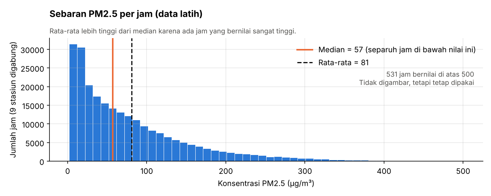
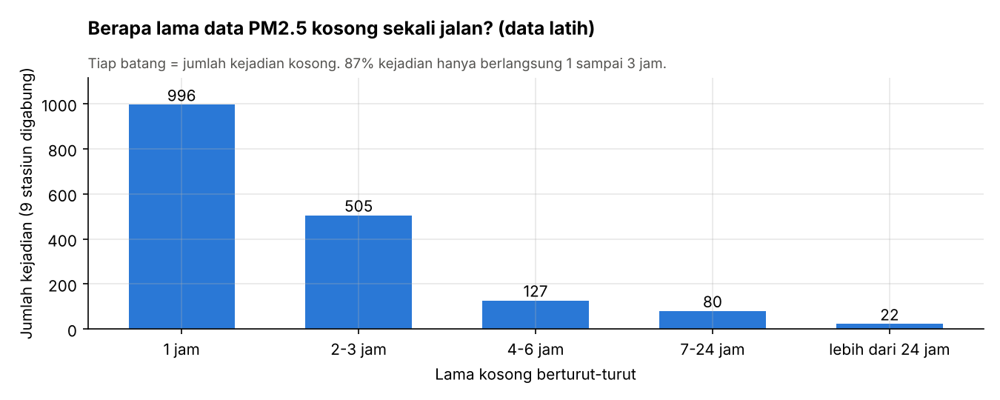
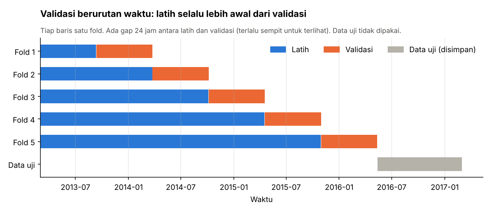
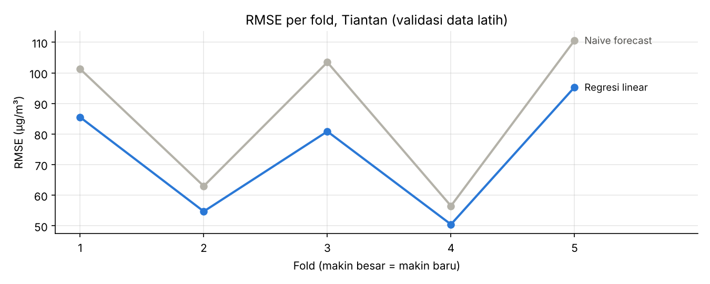
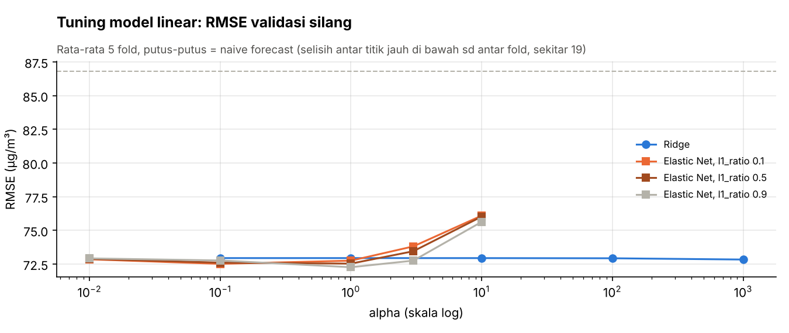
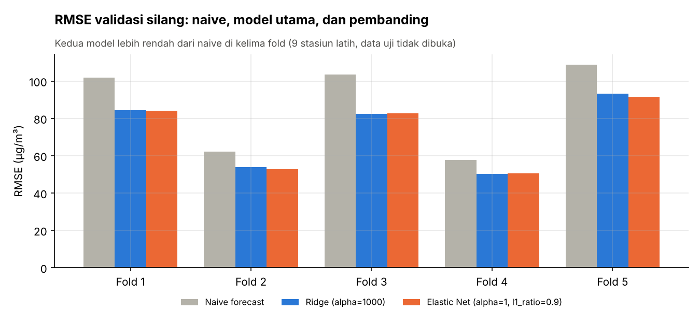

# Penjelasan Proyek dan Alur Tahapan

Ringkasan versi mudah dibaca. Angka diambil dari hasil eksekusi *notebook* pada data latih. Data uji belum pernah dibuka.

## 1. Topik dan studi kasus

**Memprediksi konsentrasi PM2.5 di Beijing, 24 jam ke depan.**

PM2.5 adalah partikel debu sangat halus (diameter 2,5 mikrometer atau kurang) yang bisa masuk ke paru-paru. Semakin tinggi konsentrasinya, semakin berbahaya bagi kesehatan.

Jenis tugasnya adalah **regresi deret waktu**: model menebak sebuah angka (PM2.5) dari data yang urut menurut waktu.

### Studi kasus (skenario ilustrasi)

Misalkan seorang warga Beijing pada pukul 10.00 yang ingin tahu apakah besok pukul 10.00 aman untuk berolahraga di luar ruangan atau mengantar anak ke sekolah dengan berjalan kaki. Ia tidak butuh tahu PM2.5 sekarang, karena itu bisa dilihat di aplikasi. Ia butuh perkiraan untuk besok, supaya punya waktu menyiapkan masker atau mengubah rencana.

Dari skenario ini kita tahu apa yang harus dibuat: sebuah model yang pada pukul 10.00 hari ini menebak PM2.5 pada pukul 10.00 besok, yaitu 24 jam ke depan.

Agar model bisa belajar menebak, ia butuh contoh dari masa lalu. Setiap contoh berisi kondisi udara dan cuaca pada satu jam, beserta PM2.5 yang terukur 24 jam sesudahnya. Semakin banyak dan semakin beragam contohnya, semakin baik model belajar pola, misalnya kapan polusi cenderung naik. Contoh seperti itu tersedia di dataset berikut.

## 2. Dataset

**Beijing Multi-Site Air Quality** dari UCI (https://archive.ics.uci.edu/dataset/501).

12 berkas CSV, satu per stasiun pemantau udara di Beijing. Satu baris adalah satu jam pengukuran, dari 1 Maret 2013 sampai 28 Februari 2017. Total 420.768 baris (12 stasiun × 35.064 jam), dengan 18 kolom yang sama di tiap berkas.

| Kelompok | Kolom | Arti |
|---|---|---|
| Waktu dan tempat | `No`, `year`, `month`, `day`, `hour`, `station` | Nomor baris, tahun, bulan, tanggal, jam, dan nama stasiun |
| Polutan | `PM2.5`, `PM10`, `SO2`, `NO2`, `CO`, `O3` | Konsentrasi partikel dan gas di udara. `PM2.5` adalah yang diprediksi |
| Cuaca | `TEMP`, `PRES`, `DEWP`, `RAIN`, `WSPM`, `wd` | Suhu, tekanan, titik embun, hujan, kecepatan angin, dan arah angin (16 kategori teks) |

Nilai kosong ditandai `NA`. `PM2.5` kosong pada 2,08% baris, dan kolom lain 0,08% sampai 4,92%. Satuan mengikuti dokumentasi UCI (belum dicek ulang di halaman UCI).

**Peran kolom di proyek:** target adalah `PM2.5` pada jam t+24 (nilai `PM2.5` yang digeser 24 jam). Fitur berasal dari polutan dan cuaca pada jam t, riwayat `PM2.5`, dan kalender dari bulan, hari, dan jam. Kolom `No` tidak dipakai.

### Stasiun latih dan stasiun uji


Data mencakup 2013-03-01 sampai 2017-02-28. Gambar dan tabel berikut membagi 9 stasiun latih dan 3 stasiun uji menurut waktu: 80% awal adalah sebelum 2016-05-12 19:00, 20% akhir mulai 2016-05-12 19:00, dengan batas waktu yang sama untuk semua stasiun.

| Kotak | Isi | Porsi baris | Peran |
|---|---|---|---|
| 9 stasiun latih, 80% awal | LATIH | 60% | Melatih model, memilih model, dan *tuning* (`TimeSeriesSplit`, 5 *fold*, *gap* 24 jam) |
| 9 stasiun latih, 20% akhir | UJI | 15% | Menguji masa depan di stasiun yang ikut dilatih |
| 3 stasiun uji, 80% awal | TIDAK DIPAKAI | 20% | Sengaja dibuang supaya model belum pernah melihat 3 stasiun ini sebelum diuji |
| 3 stasiun uji, 20% akhir | UJI | 5% | Menguji stasiun yang tidak ikut dilatih, sekaligus masa depan |

Dari 12 stasiun, **9 dipakai untuk melatih model** dan **3 stasiun uji**: model tidak pernah melihat data 3 stasiun itu. Data waktu dibagi sama untuk semua stasiun: 80% awal untuk latih dan 20% akhir untuk uji. Ini keputusan penulis (16 Nov 2026), belum dikonfirmasi dosen. Aturan dosen hanya menetapkan uji = 20% periode terakhir dan adanya uji di stasiun lain.

Uji akhir dilakukan pada 20% periode terakhir dari semua 12 stasiun, dilaporkan terpisah: (1) 9 stasiun latih, untuk melihat apakah model bagus memprediksi masa depan, dan (2) 3 stasiun uji, untuk melihat apakah model masih bagus di stasiun yang belum pernah dilihat. Selisih galat keduanya menunjukkan pergeseran distribusi. Tiga stasiun uji dipilih dengan aturan: satu yang jauh, satu sedang, dan satu dekat dari stasiun lain berdasarkan data periode latih saja. Hasilnya Dingling, Wanliu, dan Shunyi, yang sudah ditetapkan penulis (16 Nov 2026). Tiantan dan Dingling dipakai pada tahap awal sebagai percobaan (pilot), dan hasilnya dihitung ulang untuk desain ini.

Pembagian murni per stasiun pada seluruh periode tidak dipakai karena jam yang sama muncul di data latih dan uji. PM2.5 antar stasiun saling berkaitan pada jam yang sama (korelasi median 0,88), sehingga jawaban data uji ikut terlihat oleh model.

## 3. Rumusan masalah

> Model ini membantu warga dan otoritas kesehatan lingkungan memutuskan pembatasan paparan, dengan memprediksi PM2.5 24 jam ke depan dari riwayat PM2.5, polutan lain, dan cuaca sampai jam prediksi. Kesalahan yang paling merugikan adalah galat besar, terutama prediksi yang terlalu rendah saat polusi tinggi, sehingga metrik utama adalah RMSE.

**RMSE** adalah ukuran rata-rata seberapa jauh tebakan dari kenyataan, dengan kesalahan besar dihukum lebih berat. Cocok di sini karena meleset jauh saat polusi tinggi paling merugikan. MAE dipakai sebagai pendamping.

Tiga tantangan wajib dari dosen:

1. **Nilai hilang pada sensor.** Data yang kosong tidak boleh diisi dengan nilai dari jam sesudahnya.
2. **Validasi berurutan waktu.** Data tidak boleh diacak, karena model hanya boleh belajar dari masa lalu untuk menebak masa depan.
3. **Uji di stasiun lain.** Model dari satu stasiun dicoba di stasiun berbeda untuk melihat apakah kinerjanya turun (pergeseran distribusi).

## 4. Tujuan

1. Membangun model prediksi PM2.5 24 jam ke depan yang dievaluasi dengan **benar dan bebas kebocoran data**.
2. Mengukur seberapa jauh model lebih baik dari tebakan paling sederhana, yaitu menganggap PM2.5 besok sama dengan PM2.5 sekarang (*baseline*).
3. Menguji apakah model tetap andal di stasiun lain.
4. Menganalisis kapan dan mengapa model salah, termasuk siapa yang dirugikan.

Yang dinilai dosen bukan skor tertinggi. Model sederhana yang dievaluasi dengan benar lebih berharga daripada model rumit yang skornya bagus karena bocor.

*Kebocoran data* berarti informasi dari data uji ikut terlihat oleh model saat belajar, sehingga skor tampak lebih bagus daripada kenyataannya. Seluruh rancangan tahap 1 sampai 4 dibuat untuk mencegah hal ini.

## 5. Alur dari tahap ke tahap

```
Tahap 1          Tahap 2           Tahap 3            Tahap 4
Rumusan    →    Eksplorasi   →    Cara menguji  →    Baseline
masalah         dan rapikan       model              (naive forecast)
                data              (validasi)
                                                         │
                                          Pertemuan 13 (cek bersama dosen)
                                                         │
Tahap 5          Tahap 6           Tahap 7               ↓
Model       →    Evaluasi     →    Analisis kesalahan
lanjutan         akhir pada        dan etika
dan tuning       data uji
```

Urutannya penting. Cara menguji model (tahap 3) ditetapkan **sebelum** model dibangun, supaya hasil model tidak bisa mengubah cara pengujiannya.

### Tahap 1. Rumusan masalah dan metrik

Tahap 1 dikerjakan sebelum membuka data. Panduan meminta tiga pertanyaan dijawab tertulis (siapa pemakainya, keputusan apa yang diambil, kesalahan mana yang paling merugikan). Di sini ditambah dua baris: apa yang diprediksi dan bagaimana mengukurnya.

| Pertanyaan | Jawaban di proyek ini |
|---|---|
| Apa yang diprediksi? | PM2.5 pada 24 jam ke depan (jam t+24) di stasiun pemantau Beijing. Model dilatih dari 9 stasiun dan dicoba di 3 stasiun uji untuk melihat apakah berlaku di tempat lain |
| Untuk siapa? | Warga dan otoritas kesehatan lingkungan |
| Keputusan apa yang diambil dari prediksi? | Membatasi paparan, misalnya aktivitas di luar ruangan dan pemakaian masker |
| Kesalahan mana yang paling merugikan? | Galat besar, terutama prediksi yang terlalu rendah saat polusi tinggi |
| Bagaimana mengukurnya? | **RMSE** sebagai metrik utama, karena menghukum galat besar lebih berat. MAE sebagai pendamping |

### Tahap 2. Eksplorasi dan praproses

**Tujuan:** mengubah data mentah menjadi tabel latihan yang siap dibaca model. Setiap baris tabel berisi dua hal: **fitur** (yang sudah diketahui) dan **target** (yang harus ditebak).

**Contoh satu baris.** Anggap sekarang Senin pukul 10.00 (disebut jam t).

- Fitur: semua yang sudah terukur sampai saat ini, misalnya PM2.5 pagi ini, PM10, suhu, angin, dan PM2.5 kemarin.
- Target: PM2.5 pada Selasa pukul 10.00 (jam t+24), yang belum terjadi.

Model belajar dari banyak baris seperti ini: dari fitur pada jam t, tebak target 24 jam kemudian.

```
 Senin 10.00 (jam t)                                  Selasa 10.00 (jam t+24)
        │                                                      │
        ▼                                                      ▼
 FITUR: yang sudah terukur                            TARGET: PM2.5 yang
 (PM2.5 sekarang, PM10, suhu,    ── 24 jam ke depan ─▶ ingin ditebak
  angin, PM2.5 kemarin, dst.)                          (belum terjadi)
```

**Aturan terpenting: fitur tidak boleh memakai data sesudah jam t.** Saat prediksi dibuat di dunia nyata, data sesudah jam t memang belum ada. Jika sebuah fitur memakainya, skor model terlihat bagus tetapi model itu tidak bisa dipakai sungguhan. Hal ini disebut *kebocoran data*.

#### Isi tabel: 29 fitur

| Kelompok | Isi | Jumlah | Mengapa dipakai |
|---|---|---|---|
| Kondisi pada jam t | PM2.5, PM10, SO2, NO2, CO, O3, suhu, tekanan, titik embun, hujan, kecepatan angin | 11 | Keadaan udara dan cuaca saat ini |
| Riwayat PM2.5 (*lag*) | PM2.5 pada 1, 2, 3, 6, 12, 24, dan 48 jam sebelum jam t | 7 | PM2.5 cenderung mirip dengan beberapa jam atau hari sebelumnya |
| *Rolling mean* | rata-rata PM2.5 selama 6, 24, dan 72 jam terakhir (jam t ikut dihitung, jam sesudahnya tidak) | 3 | Gambaran tren jangka pendek sampai menengah |
| Arah angin | diubah menjadi sinus dan kosinus | 2 | Arah berbentuk lingkaran (0 derajat sama dengan 360 derajat), jadi dipecah menjadi dua angka agar nilai yang berdekatan tetap tampak dekat |
| Kalender | jam, hari, dan bulan, masing-masing sebagai sinus dan kosinus | 6 | Pola yang berulang. Dengan sinus dan kosinus, pukul 23.00 tercatat dekat dengan pukul 00.00 |

Fitur yang sama dibuat untuk tiap stasiun (9 stasiun latih dan 3 stasiun uji, lihat bagian 2), masing-masing dihitung hanya dari data stasiun itu sendiri.

#### Langkah yang dikerjakan

1. **Mengenali data (EDA).** Temuan pada data latih 9 stasiun:
   - PM2.5 miring ke kanan: kebanyakan jam bernilai rendah (median 57), tetapi ada jam bernilai sangat tinggi yang menarik rata-rata ke 81. Jam sangat tinggi ini menghasilkan galat besar sehingga akan mendominasi RMSE.
   - Rata-rata tertinggi terjadi di bulan Desember (terendah Agustus) dan pada pukul 21.00 (terendah pukul 16.00).
   - PM2.5 kosong pada 2,16% jam. Nilai ekstrem 999 dipertahankan.



*Cara membaca:* tinggi batang adalah jumlah jam. Sebagian besar jam ada di sisi kiri (udara relatif bersih), dan sedikit jam di sisi kanan (polusi parah) menarik rata-rata ke kanan.

2. **Menyisihkan data uji sejak awal.** Data mulai 12 Mei 2016 dipisahkan sebelum eksplorasi dan tidak dibuka.
3. **Membuat fitur dan target** seperti tabel di atas.
4. **Membuang baris latih yang targetnya masuk periode uji.** Contoh: baris pukul 20.00 tanggal 11 Mei 2016 punya target pukul 20.00 tanggal 12 Mei, padahal batas uji adalah 12 Mei pukul 19.00. Baris seperti ini (24 jam terakhir sebelum batas) dibuang supaya data latih tidak memuat informasi dari periode uji.
5. **Menangani nilai hilang.**
   - Baris yang targetnya kosong dibuang, karena tidak ada jawaban untuk dipelajari.
   - Fitur yang kosong diisi median, dan median itu dihitung dari data latih saja.
   - Nilai dari jam sesudah rentang nilai hilang tidak dipakai untuk mengisi, karena itu berarti memakai informasi dari masa depan.



*Cara membaca:* tiap batang adalah jumlah kejadian kosong menurut lamanya. Ada 1.730 kejadian, median 1 jam, terpanjang 343 jam. Kebanyakan rentang nilai hilang pendek, tetapi yang panjang dan jarang terjadi tetap perlu diperhatikan.
6. **Menjustifikasi dua pilihan.**
   - *Forward fill*: pengisian nilai hilang sampai beberapa batas jam dibandingkan, dan hasilnya tidak berbeda nyata (selisihnya sebanding dengan *noise* antar pengulangan). Maka dipilih cara paling sederhana, yaitu tanpa *forward fill*.
   - Stasiun uji: pada pilot, Dingling dipilih karena distribusi PM2.5-nya paling berbeda dari Tiantan. Namun uji pada data latih tidak membuktikan Dingling paling sulit diprediksi. Pada desain 9 stasiun latih dan 3 stasiun uji (16 Nov 2026), peran ini diganti tiga stasiun uji, yaitu Dingling, Wanliu, dan Shunyi (ditetapkan penulis, dasarnya aturan di *notebook* 02.2).

**Hasil:** 246.798 baris latih (9 stasiun) dengan 29 fitur, dan 82.151 baris uji yang disimpan tanpa dibuka (61.686 dari stasiun latih dan 20.465 dari stasiun uji).

### Tahap 3. Skema validasi

Menetapkan cara menguji model supaya skornya tidak terlalu optimistis.
- Data diurutkan menurut waktu. **20% terakhir disimpan sebagai data uji** (mulai 12 Mei 2016) dan hanya dibuka satu kali di akhir.
- Sisanya (80%) dipakai untuk memilih model dengan `TimeSeriesSplit` 5 *fold*, dengan *gap* 24 jam. Target sebuah baris latih adalah PM2.5 24 jam sesudahnya, jadi tanpa *gap*, target baris latih terakhir bisa jatuh di periode validasi. *Gap* 24 jam mencegah hal itu.
- Pengisian nilai hilang dan penskalaan dihitung dari data latih saja pada setiap *fold*, tidak dari data validasi atau data uji. Ini dilakukan dengan menaruhnya di dalam *pipeline*.
- Kelemahan yang diakui: hanya 5 *fold*, simpangan baku antar *fold* besar, dan statistik ringkas periode uji pernah dilihat (7 dan 15 Nov 2026), tetapi tidak dipakai untuk memilih fitur, model, atau pengaturan.



*Cara membaca:* tiap baris satu *fold*. Biru adalah data untuk belajar, oranye adalah data untuk menguji di *fold* itu, selalu lebih baru dari yang biru. Abu-abu adalah data uji akhir yang belum dibuka.

### Tahap 4. *Baseline*

Hasil *baseline*. Model lanjutan baru dianggap berguna jika RMSE-nya lebih kecil dari angka ini.

| Model | RMSE (rata-rata ± sd antar *fold*) |
|---|---|
| *Naive forecast* (tebak PM2.5 besok sama dengan sekarang) | 86,82 ± 24,70 |

Angka ini hasil pada data latih (9 stasiun), bukan data uji.



*Cara membaca:* makin pendek batang, makin kecil galatnya. *Fold* 1, 3, dan 5 (validasi mencakup musim dingin) galatnya sekitar 100, sedangkan *fold* 2 dan 4 (musim hangat) sekitar 60. Simpangan baku yang besar kemungkinan terutama mencerminkan beda musim, bukan model yang tidak stabil.

### Tahap 5. Model lanjutan dan *tuning*

Dua model lanjutan, keputusan penulis (22 Nov 2026). Keduanya linear, memakai **29 fitur yang sama**, dan dilatih pada 9 stasiun latih:

| Peran | Model | Cara kerja singkat |
|---|---|---|
| Utama | **Ridge** | Memberi bobot pada tiap fitur dan menjaga bobot agar tidak terlalu besar (*alpha* adalah kekuatan "rem" itu) |
| Pembanding | **Elastic Net** | Seperti Ridge, dan bisa membuat bobot fitur yang tidak berguna menjadi nol |

Mengapa model linear? Bobot tiap fitur bisa dibaca, jadi mudah dijelaskan dan dipertanggungjawabkan.

**Cara menguji.** Sama seperti *naive*: lima *fold* berurutan waktu dengan *gap* 24 jam, baris yang dinilai sama persis, dan praproses yang belajar hanya dari data latih tiap *fold*. Data uji tidak dibuka. Satu perbedaan perlu diakui: kedua model dilatih dan pengaturannya (*alpha*) dipilih pada *fold* yang sama, sehingga skornya sedikit optimistis.

**Memilih pengaturan.** Ada 20 pengaturan yang dicoba (Ridge 5, Elastic Net 15). Daftarnya ditetapkan sebelum dijalankan dan tidak diubah setelah melihat hasil. Hasilnya hampir datar: RMSE Ridge hanya bergeser dari 72,94 ke 72,83 ketika *alpha* diubah dari 0,1 ke 1000, jadi hasil tidak bergantung pada angka *alpha*.



**Hasil.**

| Model | RMSE (rata-rata ± sd antar *fold*) | MAE | Perbaikan vs *naive* | *Fold* lebih baik dari *naive* |
|---|---|---|---|---|
| *Naive forecast* | 86,82 ± 24,70 | 59,39 ± 16,53 | n/a | n/a |
| Ridge, `alpha=1000` (utama) | 72,83 ± 19,38 | 54,51 ± 13,00 | 16,1% | 5 dari 5 |
| Elastic Net, `alpha=1`, `l1_ratio=0,9` (pembanding) | 72,26 ± 19,23 | 54,43 ± 13,31 | 16,8% | 5 dari 5 |



*Cara membaca:* di setiap *fold*, kedua model lebih rendah dari *naive*. Selisih kedua model hanya 0,57, jauh di bawah simpangan baku antar *fold* (sekitar 19), dan Elastic Net lebih baik hanya di 3 dari 5 *fold*. Jadi keduanya **setara**, dan skor validasi tidak bisa menentukan pemenang. Angka ini nilai validasi, bukan kinerja akhir.

**Mengapa Ridge utama dan Elastic Net pembanding, padahal hampir sama?** Karena skor tidak bisa memilih, dipakai aturan yang ditetapkan sebelum hasil keluar: bila selisih RMSE kurang dari satu simpangan baku antar *fold* (sekitar 19), diambil keluarga model yang lebih sederhana. Ridge lebih sederhana (satu pengaturan, 5 nilai dicoba) daripada Elastic Net (dua pengaturan, 15 nilai dicoba), dan skor terbaik dari lebih banyak pilihan cenderung lebih optimistis. Elastic Net tetap dibawa sebagai pembanding untuk menjawab satu pertanyaan: apakah membuang fitur membantu? Di validasi ini belum terbukti membantu. Label utama dan pembanding adalah aturan kerja, bukan klaim bahwa Ridge lebih akurat; menukar perannya sama bisa dipertanggungjawabkan. Model dibekukan dulu, lalu data uji dibuka satu kali di Tahap 6.

### Tahap 6. Evaluasi dan diagnosis

Memeriksa apakah model terlalu sederhana (*underfitting*) atau terlalu menghafal (*overfitting*) dengan *learning curve*. Setelah model final dipilih, **data uji dibuka satu kali**, untuk 9 stasiun latih dan 3 stasiun uji. Jika skornya jauh lebih buruk dari validasi, model tidak disetel ulang. Selisihnya dilaporkan dan dianalisis.

### Tahap 7. Analisis kesalahan dan etika

Mencari di mana model paling sering salah (jam, musim, stasiun, rentang konsentrasi), fitur mana yang paling berpengaruh, dan siapa yang dirugikan jika prediksi terlalu rendah. Model dipakai sebagai alat bantu peringatan, bukan pengambil keputusan otomatis.
