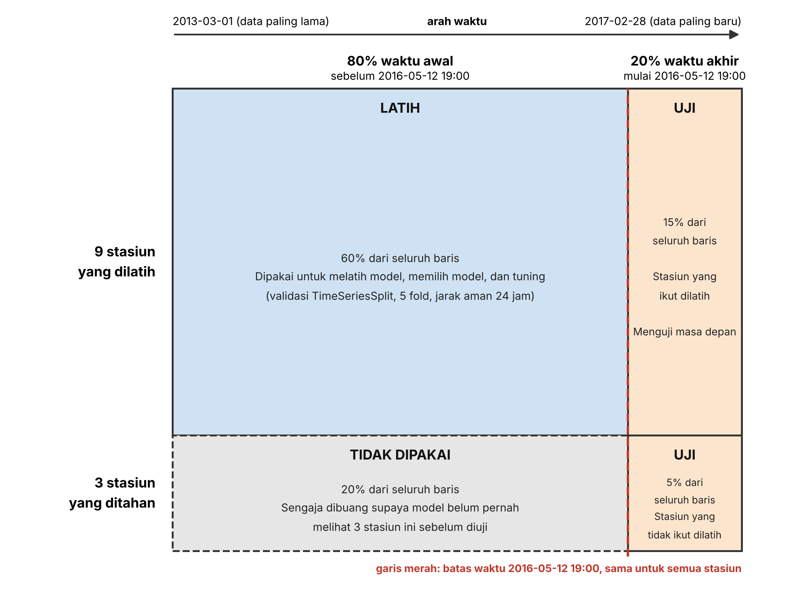

# Ringkasan Hasil Per Tahapan: Peramalan PM2.5 Beijing

Berisi inti hasil tiap tahap, diperbarui setiap satu tahap selesai. Rincian lengkap tahap 1 ada di `Proposal/Proposal Proyek ML PM25 Beijing (Versi Panjang).md`.

| Tahap | Status |
|---|---|
| 1. Proposal dan rumusan masalah | Selesai sebagian (draf selesai, menunggu konfirmasi dosen) |
| 2. EDA dan praproses | Selesai untuk Tiantan (pilot), perlu diperluas ke desain 9/3 (dasar keputusan *forward fill* dan stasiun uji ada di *notebook* 04.6 dan 04.7) |
| 3. Skema validasi | Desain direvisi 16 Nov 2026, implementasi masih skema Tiantan (skema, pengecekan otomatis, alasan, dan keterbatasan ada di *notebook* bagian 03). Penjaga pembukaan data uji ada di bagian 03.3 dan protokol [Usulan, menunggu persetujuan] di `Protokol Evaluasi Data Uji.md`. Penjaga hanya mencegah pembukaan ganda yang tidak disengaja, dan baru teruji saat data uji dibuka. Literatur pendukung: lihat `Proposal/Catatan Verifikasi Referensi.md` (aturan `gap` sama dengan horizon belum punya sumber *peer review* yang terbaca) |
| 4. *Baseline* | Selesai sebagian, hasil pilot Tiantan (hasil validasi ada, belum dibahas dengan dosen) |
| 5. Model lanjutan dan *tuning* | Belum dikerjakan |
| 6. Evaluasi dan diagnosis | Belum dikerjakan |
| 7. Analisis kesalahan dan etika | Belum dikerjakan |

## Revisi desain evaluasi (16 Nov 2026)

Keputusan LIP 16 Nov 2026 menggantikan skema "latih di Tiantan, uji di Dingling" (opsi A) dengan desain berikut. Status: [Usulan], belum dikonfirmasi dosen. Panduan dosen hanya menetapkan uji = 20% periode terakhir dan tantangan "uji model di stasiun lain".

- **Desain:** 9 stasiun latih dan 3 stasiun ditahan. Waktu 80% awal untuk latih, 20% akhir untuk uji, dengan satu stempel waktu batas untuk semua stasiun. Uji final dibuka satu kali pada 20% akhir dari 12 stasiun, dilaporkan terpisah untuk 9 stasiun latih dan 3 stasiun ditahan.
- **Porsi baris:** latih 60%, uji 20%, tidak dipakai 20% (80% awal dari 3 stasiun ditahan, sengaja tidak dipakai agar stasiun itu tetap asing bagi model).
- **Tiga stasiun ditahan belum ditetapkan.** Aturan [Usulan]: satu jauh, satu sedang, satu dekat dari gabungan stasiun latih, berdasarkan jarak distribusi PM2.5 pada 80% data awal, dikunci sebelum 20% akhir dibuka. Kandidat awal Dingling, Huairou, Dongsi (dihitung terhadap Tiantan, harus dihitung ulang).
- **Pembagian murni per stasiun pada seluruh periode ditolak:** jam yang sama muncul di data latih dan uji, dan korelasi PM2.5 antar stasiun pada jam yang sama median 0,89, sehingga bocor lewat waktu. Besar kebocoran belum diukur.
- **Syarat teknis:** *fold* dibuat dari stempel waktu unik, `gap` 24 jam dihitung per jam, dan data tidak dipotong menurut urutan stasiun.
- **Pemeriksaan data mentah (16 Nov 2026, dari 12 CSV di repo):** setiap stasiun 35.064 baris, rentang waktu identik, tanpa duplikat waktu. Jumlah PM2.5 kosong berbeda antar stasiun (382 di Wanliu sampai 953 di Huairou, seluruh periode).
- **Dampak:** hasil Tahap 2 sampai 4 di bawah adalah hasil pilot Tiantan dan perlu dihitung ulang untuk desain ini. Dasar pemilihan Dingling (bagian Tahap 2) tetap berguna sebagai bahan memilih stasiun ditahan, tetapi Dingling tidak lagi otomatis stasiun uji.
- **Belum diputuskan:** identitas stasiun sebagai fitur, dan jawaban dosen atas desain ini. Bila dosen menolak, kembali ke opsi A+ (latih Tiantan, uji beberapa stasiun).

## Tahap 1. Proposal

- **Topik dan *dataset*:** peramalan PM2.5 per jam, regresi deret waktu, Beijing Multi-Site Air Quality (UCI, 12 stasiun, 1 Maret 2013 sampai 28 Februari 2017).
- **Rumusan masalah:** memprediksi PM2.5 pada 24 jam ke depan dari riwayat PM2.5, polutan lain, dan cuaca sampai jam prediksi, sebagai dasar keputusan warga membatasi paparan.
- **Metrik utama:** RMSE, karena galat besar paling merugikan, terutama ramalan terlalu rendah saat konsentrasi tinggi. Pendamping: MAE.
- **Validasi:** data diurutkan menurut waktu, 20% terakhir sebagai data uji (dibuka satu kali), `TimeSeriesSplit` pada 80% awal.
- ***Baseline*:** *naive forecast*. Model lanjutan dan pembanding tambahan belum ditentukan.
- **Tiga tantangan:** nilai hilang (imputasi kausal di dalam *pipeline*), validasi berurutan waktu (tanpa kebocoran), pergeseran distribusi (rencana awal: latih dan validasi di satu stasiun utama, uji di stasiun lain. Diganti 16 Nov 2026 menjadi 9 stasiun latih dan 3 stasiun ditahan, lihat bagian Revisi desain evaluasi).
- **Keputusan yang sudah ditetapkan:** horizon 24 jam (alasan: waktu bagi warga untuk membatasi paparan), skema uji stasiun lain berupa latih di satu stasiun lalu uji di stasiun lain, nilai ekstrem 999 dipertahankan, stasiun utama Tiantan. Ditambah 15 Nov 2026: stasiun uji Dingling dan tanpa *forward fill* (dasar di tahap 2). Skema uji stasiun lain dan stasiun uji Dingling digantikan desain 9 stasiun latih dan 3 stasiun ditahan pada 16 Nov 2026.
- **Referensi:** [1] Cui dkk. 2023; [2] Hewamalage dkk. 2023; [3] Hua dkk. 2024; [4] Kapoor dan Narayanan 2023; [5] Lones 2024 (detail dan status verifikasi ada di `Proposal/Catatan Verifikasi Referensi.md`).

## Tahap 2. EDA dan praproses

Semua angka berasal dari eksekusi `Notebook/Tahap 2 EDA dan Praproses.ipynb` pada stasiun Tiantan dan **hanya memakai data latih**, kecuali disebut lain. *Notebook* dijalankan ulang 15 Nov 2026 setelah keputusan tanpa *forward fill*, jarak aman 24 jam, dan penambahan *baseline* (0 *error*, 10 grafik tertanam). Dua tabel EDA identik dengan eksekusi sebelumnya.

Keluaran *notebook*: sepuluh grafik di `Hasil/Gambar/` (sembilan EDA bernama `t2_`, satu *baseline* bernama `t4_`), enam tabel di `Hasil/Tabel/` (dua EDA, tiga dasar keputusan, satu *baseline*), dan fitur siap pakai (latih dan uji) di `Data/Data Olahan/`. Berkas pilot Tiantan dihapus 16 Nov 2026 supaya *notebook* dijalankan ulang di bawah desain 9/3, sehingga angka tahap 2 sampai 4 di dokumen ini adalah hasil pilot. Berkas fitur uji hanya disimpan, tidak dibuka untuk analisis.

- **Pembagian waktu:** data uji dimulai 2016-05-12 19:00 (20% jam terakhir), disisihkan sebelum eksplorasi dan tidak dibuka. Data latih seluruh stasiun 336.612 baris (80%).
- **Sebaran PM2.5:** median 59, rata-rata 82,2, miring ke kanan (*skewness* 1,91). Galat besar saat episode polusi tinggi akan mendominasi RMSE.
- **Nilai ekstrem (12 stasiun, data latih):** 659 jam di atas 500, 32 jam di atas 700, 3 jam di atas 900, 1 jam bernilai tepat 999. Pada jam-jam di atas 700, median 10 dari 12 stasiun ikut di atas 300, jadi lonjakan itu terjadi serempak dan sejalan dengan keputusan mempertahankan nilai ekstrem. Belum ada bukti batas alat ukur.
- **Pola waktu:** rata-rata tertinggi bulan Desember (106), terendah Agustus (59). Per jam, tertinggi pukul 23.00 (89), terendah pukul 16.00 (76).
- **Nilai hilang PM2.5:** 2,08% pada data latih Tiantan, dalam 313 celah. Median celah 1 jam, terpanjang 24 jam. Celah sampai 3 jam mencakup 91% celah tetapi hanya 65% jam yang hilang.
- **Korelasi dengan PM2.5 24 jam kemudian:** PM2.5 sekarang 0,39, CO 0,34, NO2 0,33, PM10 0,32. Korelasi PM2.5 dengan nilai sebelumnya turun dari 0,39 (24 jam) ke 0,12 (48 jam) dan 0,03 (72 jam), sehingga *lag* lebih dari dua hari hampir tidak informatif.
- **Antarstasiun (rata-rata PM2.5 data latih):** Dingling 67,0, Huairou 71,0, Tiantan 82,2, Dongsi 85,7. Secara visual, pola bulanan Tiantan searah dengan tiga kandidat stasiun uji (belum diukur). Rata-rata yang berbeda belum membuktikan stasiun itu paling sulit diramal (lihat bagian stasiun uji di bawah).
- **Fitur dan target:** target PM2.5 pada jam t+24, 29 fitur yang hanya memakai data sampai jam t (kondisi sekarang, *lag* 1 sampai 48 jam, *rolling mean* 6, 24, 72 jam, kalender, arah angin). Baris latih 27.443, baris uji 6.896 (disimpan, tidak dibuka).
- **Penutupan celah kebocoran:** baris latih yang targetnya jatuh di periode uji (24 jam terakhir) dibuang.
- **Nilai hilang pada fitur (keputusan 15 Nov 2026: tanpa *forward fill*):** target yang hilang dibuang, fitur hilang diisi median di dalam *pipeline* per *fold*. Interpolasi tidak dipakai karena melihat nilai sesudahnya. Pada berkas latih, 23 dari 29 fitur masih punya sel kosong, tertinggi `CO` 3,20%.
- **Dasar keputusan *forward fill*:** pengisian 0, 1, 3, 6, 12, dan 24 jam dibandingkan pada 5 *fold* data latih Tiantan (`TimeSeriesSplit(gap=24)`, Ridge dan `HistGradientBoostingRegressor`). Ridge: RMSE 73,42 sampai 73,49. HGB: 76,81 sampai 77,34, dengan derau antar *seed* sekitar 0,6 pada pengaturan yang sama. Tidak ada beda yang bisa dibedakan dari derau, jadi dipilih yang paling sederhana. Analisis ini ada di *notebook* bagian 04.6 (tabel `Hasil/Tabel/t2_tabel_ffill.csv`) dan angkanya sama dengan hasil skrip sebelumnya. Pada analisis pertama tanpa jarak aman, HGB tampak lebih baik 1,2 tanpa pengisian. Keunggulan itu mengecil menjadi 0,3 setelah jarak aman 24 jam dipasang, sehingga alasan tersebut tidak dipakai.
- **Stasiun uji: Dingling (keputusan 15 Nov 2026, digantikan desain 9/3 pada 16 Nov 2026; analisis ini tetap menjadi bahan memilih stasiun ditahan).** Dasarnya hanya distribusi PM2.5 data latih yang paling berbeda dari Tiantan (rata-rata 67,0, jarak Wasserstein 15,2, KS 0,115, korelasi per jam 0,80). Pada uji transfer (latih di Tiantan, validasi di stasiun lain, data latih saja), biaya transfer semua stasiun kecil: Dingling +0,33% (Ridge) dan −2,74% (HGB), dalam simpangan baku antar *fold*. Jadi Dingling **tidak terbukti paling sulit**, dan hasil di data uji nanti dilaporkan apa adanya. Perhitungannya ada di *notebook* bagian 04.7 (`t2_tabel_distribusi_stasiun.csv` dan `t2_tabel_transfer.csv`).
- **Belum dikerjakan:** penamaan *notebook* akhir (`D082261018_Muhammad Alif Qadri_ProyekML.ipynb`).

## Tahap 3. Skema validasi

- **Pembagian:** uji = 20% jam terakhir (mulai 2016-05-12 19:00, dibuka satu kali di akhir), tanpa diacak. Pemilihan model dan *tuning* memakai `TimeSeriesSplit(n_splits=5, gap=24)` pada data latih.
- **Jarak aman 24 jam (`gap=24`):** target sebuah baris adalah PM2.5 24 jam sesudahnya. Tanpa jarak, target baris latih terakhir pada tiap *fold* jatuh di periode validasi, padahal nilai itu juga muncul sebagai fitur *lag* di data validasi. Celah ini ditemukan 15 Nov 2026 saat pemeriksaan ulang dan ditutup. Pengecekannya ada di *notebook* (`assert` di bagian 03 dan 04.5).
- **Alasan tiap pilihan** (rinci di *notebook* 03.1): data berurutan waktu sehingga tidak boleh diacak, jendela latih melebar meniru pemakaian nyata, 5 *fold* mengikuti contoh panduan dan bergantian mencakup musim dingin (*fold* 1, 3, 5) dan musim hangat (*fold* 2, 4), dan data uji dibuka satu kali. *Notebook* juga memuat tabel risiko kebocoran beserta penjagaannya.
- **Keterbatasan** (rinci di *notebook* 03.2): lima *fold* sedikit dan simpangan baku RMSE antar *fold* besar, periode uji hanya sekitar 9,5 bulan (tanpa Maret sampai awal Mei), hanya satu pembagian uji, uji stasiun lain memakai periode yang sama dengan uji utama, dan penyebab perbedaan skor antar *fold* belum diuji.
- **Keterbukaan:** statistik ringkas periode uji pernah terlihat (profil awal 7 Nov di dokumen konteks, dan ringkasan berkas fitur uji saat pemeriksaan 15 Nov). Tidak dipakai untuk memilih fitur, model, atau pengaturan, tetapi perlu diakui di bagian keterbatasan laporan.
- **Lima *fold*:** validasi berturut-turut 2013-09-11 sampai 2014-03-25, 2014-03-25 sampai 2014-10-05, 2014-10-05 sampai 2015-04-18, 2015-04-18 sampai 2015-10-30, dan 2015-10-30 sampai 2016-05-11. Tiap *fold* melatih dengan masa lalu dan memvalidasi dengan periode sesudahnya.

## Tahap 4. *Baseline*

Validasi 5 *fold* pada data latih Tiantan, tanpa menyentuh data uji. Baris validasi yang PM2.5 jam *t*-nya kosong (428 dari 22.865) dibuang dari kedua model supaya dibandingkan pada baris yang sama.

| Model | RMSE rata-rata ± sd | MAE rata-rata ± sd |
|---|---|---|
| *Naive forecast* (PM2.5 jam *t+24* = PM2.5 jam *t*) | 86,97 ± 25,19 | 59,96 ± 16,96 |
| Regresi linear (*pipeline* 04.3, pembanding [Usulan]) | 73,38 ± 19,73 | 55,20 ± 12,73 |

- Regresi linear lebih baik dari *naive* pada kelima *fold*. RMSE per *fold* sama-sama naik turun mengikuti periode (*fold* 1, 3, dan 5 lebih tinggi), jadi simpangan baku yang besar kemungkinan berasal dari beda periode antar *fold* (belum diuji penyebabnya).
- Ini hasil validasi data latih, bukan data uji. Skor uji dibuka satu kali di akhir.
