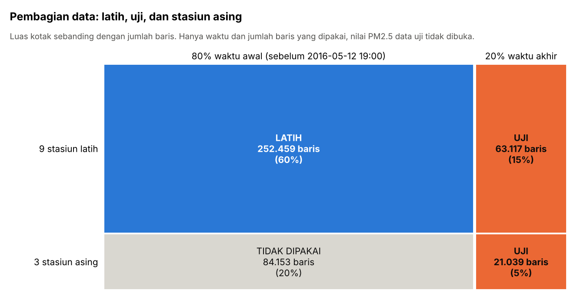

# Ringkasan Hasil Per Tahapan: Peramalan PM2.5 Beijing

Berisi inti hasil tiap tahap, diperbarui setiap satu tahap selesai. Rincian lengkap tahap 1 ada di `Proposal/Proposal Proyek ML PM25 Beijing (Versi Panjang).md`.

| Tahap | Status |
|---|---|
| 1. Proposal dan rumusan masalah | Selesai sebagian (draf selesai, menunggu konfirmasi dosen) |
| 2. EDA dan praproses | Selesai, dijalankan penuh 21 Nov 2026 pada desain 9/3 (lokal dan Colab, angka sama). Angka di bawah memakai data latih 9 stasiun |
| 3. Skema validasi | Desain 9/3 sudah diimplementasikan dan dijalankan 21 Nov 2026 (skema, pengecekan otomatis, alasan, dan keterbatasan ada di *notebook* bagian 03). Penjaga pembukaan data uji ada di bagian 03.3 dan protokol [Usulan, menunggu persetujuan] di `Protokol Evaluasi Data Uji.md`. Penjaga hanya mencegah pembukaan ganda yang tidak disengaja, dan baru teruji saat data uji dibuka. Literatur pendukung: lihat `Proposal/Catatan Verifikasi Referensi.md` (aturan `gap` sama dengan horizon belum punya sumber *peer review* yang terbaca) |
| 4. *Baseline* | Selesai, hasil validasi 9 stasiun latih (dijalankan 21 Nov 2026) |
| 5. Model lanjutan dan *tuning* | Selesai sebagian: perbandingan awal 3 keluarga model (6 konfigurasi) dengan *cross-validation* pada data latih 9 stasiun, dijalankan 22 Nov 2026. Eksperimen lanjutan fitur, model, *tuning*, dan transformasi target (05.5) dijalankan 22 Nov 2026: RMSE validasi terendah 71,09, tidak ada di bawah 70. *Tuning* sistematis Ridge dan Elastic Net (05.7) juga dijalankan: aturan memilih Ridge `alpha=1000`, RMSE 72,83, kurva datar. Model final belum dipilih, konfigurasi belum dibeku, data uji belum dibuka |
| 6. Evaluasi dan diagnosis | Belum dikerjakan |
| 7. Analisis kesalahan dan etika | Belum dikerjakan |

## Revisi desain evaluasi (16 Nov 2026)

Keputusan penulis 16 Nov 2026 menggantikan skema "latih di Tiantan, uji di Dingling" (opsi A) dengan desain berikut. Status: disetujui dosen. Panduan dosen hanya menetapkan uji = 20% periode terakhir dan tantangan "uji model di stasiun lain".

- **Desain:** 9 stasiun latih dan 3 stasiun uji. Waktu 80% awal untuk latih, 20% akhir untuk uji, dengan satu stempel waktu batas untuk semua stasiun. Uji final dibuka satu kali pada 20% akhir dari 12 stasiun, dilaporkan terpisah untuk 9 stasiun latih dan 3 stasiun uji.
- **Porsi baris:** latih 60%, uji 20%, tidak dipakai 20% (80% awal dari 3 stasiun uji, sengaja tidak dipakai agar model belum pernah melihat stasiun itu sebelum diuji).
- **Tiga stasiun uji: Dingling, Wanliu, Shunyi [Keputusan penulis, 16 Nov 2026, ditetapkan sebelum data uji dibuka].** Dasarnya aturan: urutan ke-1, ke-6, dan ke-12 menurut jarak Wasserstein PM2.5 terhadap gabungan 11 stasiun lain, hanya dari data sebelum batas waktu (Dingling paling berbeda, Wanliu sedang, Shunyi paling mirip). *Notebook* 02.2 memeriksa bahwa aturan itu masih menghasilkan daftar yang sama. Mengubahnya berarti mengubah keputusan dan menjalankan ulang semua hasil.
- **Pembagian murni per stasiun pada seluruh periode ditolak:** jam yang sama muncul di data latih dan uji, dan korelasi PM2.5 antar stasiun pada jam yang sama median 0,88, sehingga bocor lewat waktu. Besar kebocoran belum diukur.
- **Syarat teknis:** *fold* dibuat dari stempel waktu unik, `gap` 24 jam dihitung per jam, dan data tidak dipotong menurut urutan stasiun.
- **Pemeriksaan data mentah (16 Nov 2026, dari 12 CSV di repo):** setiap stasiun 35.064 baris, rentang waktu identik, tanpa duplikat waktu. Jumlah PM2.5 kosong berbeda antar stasiun (382 di Wanliu sampai 953 di Huairou, seluruh periode).
- **Dampak:** *notebook* menerapkan desain ini dan dijalankan penuh 21 Nov 2026. Hasil Tahap 2 sampai 4 di bawah dan berkas di `Hasil/Tabel/` (kecuali `t2_tabel_transfer.csv`, sisa pilot) berasal dari jalan itu. Dasar pemilihan Dingling di versi pilot tetap berguna sebagai bahan memilih stasiun uji.
- **Identitas stasiun tidak dipakai sebagai fitur** (keputusan penulis 16 Nov 2026, dikukuhkan 21 Nov 2026). Alasannya: tiga stasiun uji tidak pernah muncul di data latih, dan validasi 5 *fold* hanya memakai 9 stasiun latih sehingga tidak bisa menilai manfaat fitur ini untuk stasiun baru. Dampaknya pada akurasi di stasiun latih belum diuji. Desain 9/3 sudah disetujui dosen.

## Tahap 1. Proposal

- **Topik dan *dataset*:** peramalan PM2.5 per jam, regresi deret waktu, Beijing Multi-Site Air Quality (UCI, 12 stasiun, 1 Maret 2013 sampai 28 Februari 2017).
- **Rumusan masalah:** memprediksi PM2.5 pada 24 jam ke depan dari riwayat PM2.5, polutan lain, dan cuaca sampai jam prediksi, sebagai dasar keputusan warga membatasi paparan.
- **Metrik utama:** RMSE, karena galat besar paling merugikan, terutama prediksi terlalu rendah saat konsentrasi tinggi. Pendamping: MAE.
- **Validasi:** data diurutkan menurut waktu, 20% terakhir sebagai data uji (dibuka satu kali), `TimeSeriesSplit` pada 80% awal.
- ***Baseline*:** *naive forecast*. Model lanjutan dan pembanding tambahan belum ditentukan.
- **Tiga tantangan:** nilai hilang (imputasi kausal di dalam *pipeline*), validasi berurutan waktu (tanpa kebocoran), pergeseran distribusi (rencana awal: latih dan validasi di satu stasiun utama, uji di stasiun lain. Diganti 16 Nov 2026 menjadi 9 stasiun latih dan 3 stasiun uji, lihat bagian Revisi desain evaluasi).
- **Keputusan yang sudah ditetapkan:** horizon 24 jam (alasan: waktu bagi warga untuk membatasi paparan), skema uji stasiun lain berupa latih di satu stasiun lalu uji di stasiun lain, nilai ekstrem 999 dipertahankan, stasiun utama Tiantan. Ditambah 15 Nov 2026: stasiun uji Dingling dan tanpa *forward fill* (dasar di tahap 2). Skema uji stasiun lain dan stasiun uji Dingling digantikan desain 9 stasiun latih dan 3 stasiun uji pada 16 Nov 2026.
- **Referensi:** [1] Cui dkk. 2023; [2] Hewamalage dkk. 2023; [3] Hua dkk. 2024; [4] Kapoor dan Narayanan 2023; [5] Lones 2024 (detail dan status verifikasi ada di `Proposal/Catatan Verifikasi Referensi.md`).

## Tahap 2. EDA dan praproses

Semua angka berasal dari eksekusi `Notebook/Tahap 2 EDA dan Praproses.ipynb` pada 9 stasiun latih dan **hanya memakai data latih**, kecuali disebut lain. *Notebook* dijalankan penuh 21 Nov 2026 di lingkungan lokal dan di Colab, tanpa *error*. Angka sama, kecuali analisis HGB di 04.6 yang bergeser kecil antar lingkungan (lihat di bawah).

Keluaran *notebook*: sembilan grafik di `Hasil/Gambar/`, enam tabel di `Hasil/Tabel/` (dua EDA, tiga dasar keputusan, satu *baseline*; `t2_tabel_transfer.csv` adalah sisa pilot), dan fitur siap pakai (latih dan uji) di `Data/Data Olahan/` (tidak ikut di repo, dibuat dengan menjalankan *notebook*). Berkas fitur uji hanya disimpan, tidak dibuka untuk analisis.

- **Pembagian waktu:** data uji dimulai 2016-05-12 19:00 (20% jam terakhir), disisihkan sebelum eksplorasi dan tidak dibuka. Data latih seluruh stasiun 336.612 baris (80%).
- **Sebaran PM2.5:** median 57, rata-rata 81,1, miring ke kanan (*skewness* 1,95). Galat besar saat episode polusi tinggi akan mendominasi RMSE.
- **Nilai ekstrem (9 stasiun latih, data latih):** 531 jam-stasiun di atas 500, 23 di atas 700, 1 di atas 900, 1 bernilai tepat 999. Pada 17 jam dengan PM2.5 di atas 700 di suatu stasiun, median 7 dari 9 stasiun ikut di atas 300, jadi lonjakan itu terjadi serempak dan sejalan dengan keputusan mempertahankan nilai ekstrem. Belum ada bukti batas alat ukur.
- **Pola waktu:** rata-rata tertinggi bulan Desember (99), terendah Agustus (57). Per jam, tertinggi pukul 21.00 (90), terendah pukul 16.00 (75).
- **Nilai hilang PM2.5:** 2,16% pada data latih 9 stasiun, dalam 1.730 rentang nilai hilang berturut-turut. Median rentang 1 jam, terpanjang 343 jam, dan 22 rentang lebih dari 24 jam. Rentang sampai 3 jam mencakup 87% dari seluruh rentang tetapi hanya 39% jam yang hilang.
- **Korelasi dengan PM2.5 24 jam kemudian:** PM2.5 sekarang 0,40, NO2 0,35, CO 0,34, PM10 0,34. Korelasi PM2.5 dengan nilai sebelumnya turun dari 0,40 (24 jam) ke 0,14 (48 jam) dan 0,05 (72 jam), sehingga *lag* lebih dari dua hari hampir tidak informatif.
- **Antarstasiun (rata-rata PM2.5 data latih):** Dingling 67,0, Huairou 71,0, Tiantan 82,2, Dongsi 85,7. Rata-rata yang berbeda belum membuktikan stasiun itu paling sulit diprediksi (lihat bagian stasiun uji di bawah).
- **Fitur dan target:** target PM2.5 pada jam t+24, 29 fitur yang hanya memakai data sampai jam t (kondisi sekarang, *lag* 1 sampai 48 jam, *rolling mean* 6, 24, 72 jam, kalender, arah angin). Baris latih 246.798 (9 stasiun), baris uji 82.151 (61.686 dari stasiun latih dan 20.465 dari stasiun uji; disimpan, tidak dibuka).
- **Penutupan celah kebocoran:** baris latih yang targetnya jatuh di periode uji (24 jam terakhir) dibuang.
- **Nilai hilang pada fitur (keputusan 15 Nov 2026: tanpa *forward fill*):** target yang hilang dibuang, fitur hilang diisi median di dalam *pipeline* per *fold*. Interpolasi tidak dipakai karena melihat nilai sesudahnya. Pada berkas latih, 23 dari 29 fitur masih punya sel kosong, tertinggi `CO` 4,88%.
- **Dasar keputusan *forward fill*:** pengisian 0, 1, 3, 6, 12, dan 24 jam dibandingkan pada 5 *fold* data latih 9 stasiun (`TimeSeriesSplit(gap=24)`, Ridge dan `HistGradientBoostingRegressor`). Ridge: RMSE 73,16 sampai 73,23 (beda maksimum 0,07). HGB: 76,93 sampai 77,55 (beda maksimum 0,62), dengan rentang RMSE antar *seed* pada pengaturan yang sama 0,87 di lingkungan lokal dan 0,55 di Colab (beda maksimum antar pengaturan di Colab 0,96). Simpangan baku antar *fold* sekitar 19,7 (Ridge) dan 22 (HGB). Tidak ada beda yang bisa dibedakan dari *noise*, jadi dipilih yang paling sederhana (tanpa *forward fill*). Analisis ini ada di *notebook* bagian 04.6 (tabel `Hasil/Tabel/t2_tabel_ffill.csv`, dari jalan lokal). HGB bergeser sekitar 0,5 sampai 1 poin antar lingkungan, jadi selisih RMSE antar model di bawah itu tidak boleh diklaim.
- **Stasiun uji: Dingling, Wanliu, Shunyi (keputusan penulis 16 Nov 2026).** Dasarnya jarak Wasserstein PM2.5 terhadap gabungan 11 stasiun lain, hanya dari data sebelum batas waktu: Dingling 14,4 (urutan 1, rata-rata 67,0), Wanliu 5,0 (urutan 6), Shunyi 0,9 (urutan 12). Pada versi pilot (latih di Tiantan, validasi di stasiun lain), biaya transfer semua stasiun kecil dan Dingling **tidak terbukti paling sulit**, jadi hasil di data uji nanti dilaporkan apa adanya. Perhitungan pilot itu ada di riwayat git (bagian 04.7 sebelum 16 Nov 2026), dan `t2_tabel_transfer.csv` adalah sisa pilot.
- **Belum dikerjakan:** penamaan *notebook* akhir (`D082261018_Muhammad Alif Qadri_ProyekML.ipynb`).

## Tahap 3. Skema validasi

- **Pembagian:** uji = 20% jam terakhir (mulai 2016-05-12 19:00, dibuka satu kali di akhir), tanpa diacak. Pemilihan model dan *tuning* memakai `TimeSeriesSplit(n_splits=5, gap=24)` pada data latih.
- ***Gap* 24 jam (`gap=24`):** target sebuah baris adalah PM2.5 24 jam sesudahnya. Tanpa *gap*, target baris latih terakhir pada tiap *fold* jatuh di periode validasi, padahal nilai itu juga muncul sebagai fitur *lag* di data validasi. Kebocoran ini ditemukan 15 Nov 2026 saat pemeriksaan ulang dan ditutup. Pengecekannya ada di *notebook* (`assert` di bagian 03 dan 04.5).
- **Alasan tiap pilihan** (rinci di *notebook* 03.1): data berurutan waktu sehingga tidak boleh diacak, jendela latih melebar meniru pemakaian nyata, 5 *fold* mengikuti contoh panduan dan bergantian mencakup musim dingin (*fold* 1, 3, 5) dan musim hangat (*fold* 2, 4), dan data uji dibuka satu kali. *Notebook* juga memuat tabel risiko kebocoran beserta penjagaannya.
- **Keterbatasan** (rinci di *notebook* 03.2): lima *fold* sedikit dan simpangan baku RMSE antar *fold* besar, periode uji hanya sekitar 9,5 bulan (tanpa Maret sampai awal Mei), hanya satu pembagian uji, uji stasiun lain memakai periode yang sama dengan uji utama, dan penyebab perbedaan skor antar *fold* belum diuji.
- **Keterbukaan:** statistik ringkas periode uji pernah terlihat (profil awal 7 Nov di dokumen konteks, dan ringkasan berkas fitur uji saat pemeriksaan 15 Nov). Tidak dipakai untuk memilih fitur, model, atau pengaturan, tetapi perlu diakui di bagian keterbatasan laporan.
- **Lima *fold*:** validasi berturut-turut 2013-09-11 sampai 2014-03-25, 2014-03-25 sampai 2014-10-05, 2014-10-05 sampai 2015-04-18, 2015-04-18 sampai 2015-10-30, dan 2015-10-30 sampai 2016-05-11. Tiap *fold* melatih dengan masa lalu dan memvalidasi dengan periode sesudahnya.

## Tahap 4. *Baseline*

Validasi 5 *fold* pada data latih 9 stasiun, tanpa menyentuh data uji. Baris validasi yang PM2.5 jam *t*-nya kosong (3.625 dari 205.459) dibuang karena *naive forecast* tidak bisa memprediksi tanpa nilai itu.

| Model | RMSE rata-rata ± sd | MAE rata-rata ± sd |
|---|---|---|
| *Naive forecast* (PM2.5 jam *t+24* = PM2.5 jam *t*) | 86,82 ± 24,70 | 59,39 ± 16,53 |

- RMSE per *fold* (101,7 / 62,2 / 103,6 / 57,7 / 108,8) naik turun mengikuti periode (*fold* 1, 3, dan 5 lebih tinggi), jadi simpangan baku yang besar kemungkinan berasal dari beda periode antar *fold* (belum diuji penyebabnya).
- Ini hasil validasi data latih, bukan data uji. Skor uji dibuka satu kali di akhir.

## Tahap 5. Model lanjutan dan *tuning* (perbandingan awal, 22 Nov 2026)

Aturan evaluasi sama dengan Tahap 4: `TimeSeriesSplit(n_splits=5, gap=24)` pada jam unik data latih 9 stasiun, baris validasi yang sama dengan *naive forecast* (PM2.5 jam *t* tidak kosong), imputer median dan *scaler* di dalam *pipeline* per *fold*. **Data uji tidak dibuka** (tidak ada log pembukaan). Angka berasal dari eksekusi penuh `Notebook/Tahap 2 EDA dan Praproses.ipynb` bagian 05, tanpa *error*. *Notebook* memeriksa dengan `assert` bahwa galat *naive* di bagian ini sama persis dengan 04.5.

| Model | RMSE rata-rata ± sd | MAE rata-rata ± sd | Perbaikan RMSE vs *naive* | *Fold* lebih baik dari *naive* |
|---|---|---|---|---|
| *Naive forecast* | 86,82 ± 24,70 | 59,39 ± 16,53 | n/a | n/a |
| Ridge (`alpha=1`) | 72,94 ± 19,39 | 54,58 ± 12,97 | 16,0% | 5 dari 5 |
| Elastic Net (`alpha=1`) | 72,53 ± 19,37 | 54,79 ± 13,38 | 16,5% | 5 dari 5 |
| Elastic Net (`alpha=0,1`) | 72,60 ± 19,33 | 54,35 ± 13,04 | 16,4% | 5 dari 5 |
| Elastic Net (`alpha=0,01`) | 72,88 ± 19,38 | 54,54 ± 12,97 | 16,0% | 5 dari 5 |
| *Gradient boosting* | 77,10 ± 22,10 | 56,11 ± 14,50 | 11,2% | 5 dari 5 |
| *Gradient boosting* (*early stopping* bawaan) | 76,97 ± 21,75 | 56,04 ± 14,07 | 11,4% | 5 dari 5 |

Keluarannya: `Hasil/Tabel/t5_tabel_model_lanjutan.csv`, `t5_tabel_rmse_per_fold.csv`, `t5_tabel_selisih_vs_ridge.csv`, dan grafik `Hasil/Gambar/t5_01_rmse_model_lanjutan.png`.

- **Yang berdiri di data:** semua konfigurasi lebih baik dari *naive* di kelima *fold*. Model linear sekitar 16% di bawah RMSE *naive*, *boosting* sekitar 11%.
- **Yang tidak berdiri di data:** selisih antar model linear sangat kecil (paling besar 0,41, sekitar 0,6% dari RMSE) dibanding simpangan baku antar *fold* sekitar 19. Elastic Net `alpha=0,1` lebih baik dari Ridge di 5 dari 5 *fold*, tetapi hanya 0,34 µg/m³ (rata-rata, sd selisih 0,26) dan terpilih dari enam konfigurasi, jadi tidak diklaim nyata. *Gradient boosting* rata-rata 4,0 sampai 4,2 lebih buruk dari Ridge dan lebih baik hanya di 1 dari 5 *fold*.
- **Aturan pemilihan (protokol butir 2, [Usulan], menunggu persetujuan):** RMSE terendah adalah Elastic Net `alpha=1` (72,53, sd 19,37). Semua konfigurasi dalam satu simpangan baku darinya, jadi dianggap tidak terbedakan dan yang paling sederhana menjadi **kandidat: Ridge**. Ini kandidat, bukan model final. Konfigurasi belum dibekukan.
- ***Early stopping* bawaan tidak pernah berhenti:** jumlah iterasi yang dipakai 200 di kelima *fold* (batas maksimum). Varian ini praktis hanya melatih *boosting* pada sebagian data latih *fold*, dan hasilnya hampir sama dengan *boosting* tanpa *early stopping*. Pemisahan validasi internalnya acak, bukan menurut waktu.
- **Reproduksi angka penulis:** angka Ridge (72,94 ± 19,39) dan Elastic Net (72,88, 72,60, 72,53 dengan `l1_ratio=0,5`) sama dengan tangkapan layar penulis sampai dua desimal. Angka *gradient boosting* berbeda 0,3 sampai 0,4 (penulis: 76,66 ± 20,77 dan 76,77 ± 20,74), karena pengaturan *boosting* penulis tidak diketahui. Yang dipakai di sini mengikuti 04.6 (200 iterasi, *learning rate* 0,1, kedalaman 4). Selisih sebesar itu masih dalam kisaran pergeseran HGB antar lingkungan yang dicatat di Tahap 2.
- **Keterbatasan:** *tuning* belum sistematis (grid `alpha` tiga nilai dan alpha terbaik ada di tepi grid, `l1_ratio` tetap, *boosting* belum dicari *hyperparameter*-nya). Lima *fold* sedikit. Skor model terpilih dari enam konfigurasi dengan validasi yang sama sedikit optimistis, sehingga bukan kinerja akhir. Dugaan bahwa *boosting* lebih lemah karena data latih *fold* awal sedikit belum diuji.
- **Berikutnya:** (1) putuskan model yang di-*tuning*, lalu cari *hyperparameter* pada *fold* yang sama tanpa data uji, (2) setujui aturan pemilihan di `Protokol Evaluasi Data Uji.md`, (3) bekukan dan *commit* konfigurasi final, lalu tahap 6.

### Eksperimen lanjutan (bagian 05.5, 22 Nov 2026)

Pertanyaannya: adakah cara menurunkan RMSE validasi dari sekitar 72,5 ke bawah 70 tanpa melanggar aturan validasi? Semua eksperimen memakai *fold*, baris validasi, dan praproses per *fold* yang sama dengan 05.1 (`assert` membandingkan galat *naive*). **Data uji tidak dibuka.** Yang dicoba: ablasi fitur (cuaca dinamis, statistik PM2.5 dan polutan, fitur lintas stasiun), *gradient boosting*, Ridge lalu *boosting* pada residual, *random forest*, *Extra Trees*, *tuning* acak, rata-rata sederhana (bobot sama), dan transformasi target (akar kuadrat dan `log1p`). Jumlahnya sekitar 85 konfigurasi di luar enam konfigurasi 05.1. Langkah 1 dan 2 dirancang sebelum dijalankan, langkah 3 sampai 6 ditentukan setelah melihat hasil langkah sebelumnya (dicatat terbuka di *notebook*).

| Konfigurasi (validasi silang 5 *fold*) | RMSE rata-rata ± sd | Selisih vs Ridge F1 (sd selisih) | *Fold* lebih baik dari Ridge F1 |
|---|---|---|---|
| Ridge, 29 fitur awal (F1), dari 05.1 | 72,94 ± 19,39 | 0 | n/a |
| Ridge, F3 (dengan fitur lintas stasiun) | 72,28 ± 19,31 | −0,66 (0,34) | 5 dari 5 |
| *Gradient boosting* tuning terbaik, F3 | 72,08 ± 19,30 | −0,87 (1,36) | 4 dari 5 |
| *Random forest* tuning terbaik, F3 | 71,77 ± 19,53 | −1,17 (1,16) | 4 dari 5 |
| Elastic Net + HGB + *random forest*, F2 (terbaik tanpa lintas stasiun) | 71,61 ± 19,30 | −1,33 (0,85) | 5 dari 5 |
| Ridge + *random forest* (putaran 1), F3 | 71,12 ± 19,32 | −1,82 (0,57) | 5 dari 5 |
| **Ridge + *random forest* (putaran 2), F3 (terendah dari semua)** | **71,09 ± 19,40** | **−1,85 (0,59)** | **5 dari 5** |

F2 adalah F1 ditambah 11 fitur cuaca dinamis dan 6 fitur statistik. F3 adalah F2 ditambah 4 fitur lintas stasiun (rata-rata PM2.5 dan angin dari stasiun latih **lain** pada jam yang sama, hanya sampai jam *t*). Tabel lengkap 53 eksperimen ada di `Hasil/Tabel/t5_tabel_eksperimen_ringkas.csv`.

- **Tidak ada konfigurasi di bawah 70.** RMSE validasi terendah 71,09, sekitar 18,1% di bawah *naive* (86,82) dan 1,85 di bawah Ridge F1. Menembus 70 tidak tercapai dengan eksperimen ini.
- **Yang berdiri di data:** (1) fitur cuaca dan statistik tambahan hampir tidak membantu model linear (Ridge F2 72,87 vs F1 72,94). (2) Fitur lintas stasiun membantu sekitar 0,6 untuk Ridge (72,28), konsisten di 5 dari 5 *fold* (sd selisih 0,34). (3) *Random forest* yang diregularisasi kuat (`min_samples_leaf` 100 sampai 300, `max_features` 0,2 sampai 0,3, `max_samples` 0,25) dan rata-ratanya dengan Ridge memberi 71,1 sampai 71,6. (4) *Gradient boosting* bawaan (77,10) membaik ke 72,08 setelah *tuning*, tetapi tidak melewati *random forest*.
- **Yang tidak membantu:** *boosting* pada residual Ridge (74,59 sampai 76,71), transformasi `log1p` (77,5 sampai 80,1, tanpa koreksi bias) dan akar kuadrat (73,00 sampai 74,44), dan rata-rata Ridge dengan *boosting* bawaan pada F1 (72,97).
- **Perbaikan sudah mendatar.** Perluasan grid putaran 2 hanya menurunkan 71,12 menjadi 71,09. Konfigurasi terbaik tiap model masih di tepi grid, tetapi selisih antar konfigurasi di tepi itu jauh di bawah sd selisih berpasangan, jadi memperluas lebih jauh kemungkinan tidak mengubah kesimpulan (belum diuji).
- **Dua aturan pemilihan memberi jawaban berbeda.** Aturan protokol butir 2 (selisih harus melebihi satu simpangan baku antar *fold*, sekitar 19) menyatakan semua konfigurasi tidak terbedakan dari Ridge F1, jadi Ridge tetap kandidat. Perbandingan berpasangan per *fold* (sd selisih 0,57 sampai 0,59) menunjukkan ensambel Ridge + *random forest* lebih baik di 5 dari 5 *fold* dengan selisih rata-rata 1,8. Ambang berpasangan yang dipakai di *notebook* (minimal 4 dari 5 *fold*, selisih lebih dari 3 kali sd selisih dan lebih dari 1% RMSE) adalah usulan yang ditetapkan setelah melihat sebagian hasil: **[Usulan], belum disetujui, belum dipakai untuk memilih.**
- **Keterbatasan.** Skor terbaik dari puluhan konfigurasi pada lima *fold* yang sama bersifat optimistis, jadi 71,09 bukan perkiraan kinerja akhir. Perbedaan antar tujuh konfigurasi teratas (71,09 sampai 71,28) tidak bermakna. Selisih 1,85 terhadap Ridge kecil dibanding beda antar *fold* (RMSE per *fold* berkisar sekitar 48 sampai 91). Fitur lintas stasiun mengubah aturan di bagian 01 ("tanpa mencampur deret antar stasiun") dan membuat uji pada stasiun uji tidak lagi sepenuhnya terpisah dari 9 stasiun latih (pada data uji, rata-rata dihitung dari 9 stasiun latih pada jam uji yang sama, sah secara waktu). Mengapa fitur lintas stasiun dan *random forest* membantu belum diuji (dugaan: kondisi regional dan penyaringan *noise*). Hasil HGB bergeser sekitar 0,4 antar lingkungan.
- **Keputusan yang dibutuhkan dari penulis:** (1) boleh atau tidaknya F3, (2) aturan pemilihan mana yang berlaku (butir 2 protokol atau berpasangan), (3) bila F3 ditolak, kandidat terbaik adalah Elastic Net + HGB + *random forest* pada F2 (71,61), dengan catatan selisih 1,33 terhadap Ridge F1 juga bergantung pada aturan (2).

Keluaran: `Hasil/Tabel/t5_tabel_eksperimen_per_fold.csv`, `t5_tabel_eksperimen_ringkas.csv`, `t5_tabel_tuning.csv`, `t5_tabel_tuning_putaran2.csv`, dan grafik `Hasil/Gambar/t5_02_eksperimen_lanjutan.png`. Mengulang semua eksperimen memakan sekitar 45 menit (`CARI_ULANG=1`), sedangkan bawaan membaca hasil tersimpan.

### Tuning sistematis model linear (bagian 05.7, 22 Nov 2026)

Dua kandidat utama (Ridge dan Elastic Net) di-*tuning* dengan grid yang **ditetapkan sebelum dijalankan**: Ridge `alpha` 0,1; 1; 10; 100; 1000 (5 konfigurasi) dan Elastic Net `alpha` 0,01; 0,1; 1; 3; 10 dengan `l1_ratio` 0,1; 0,5; 0,9 (15 konfigurasi). Fitur F1, praproses, *fold*, dan baris validasi sama dengan 05.1 (`assert` galat *naive*). **Data uji tidak dibuka.** Tidak ada peringatan konvergensi.

| Konfigurasi | RMSE ± sd | MAE ± sd | Selisih vs Ridge `alpha=1` (sd selisih) | *Fold* lebih baik dari Ridge |
|---|---|---|---|---|
| Ridge `alpha=1` (05.1) | 72,94 ± 19,39 | 54,58 ± 12,97 | 0 | n/a |
| **Ridge `alpha=1000` (terpilih aturan)** | **72,83 ± 19,38** | **54,51 ± 13,00** | −0,11 (0,09) | 5 dari 5 |
| Elastic Net `alpha=1`, `l1_ratio=0,9` (RMSE terendah) | 72,26 ± 19,23 | 54,43 ± 13,31 | −0,68 (0,84) | 3 dari 5 |
| Elastic Net `alpha=0,1`, `l1_ratio=0,1` | 72,51 ± 19,34 | 54,30 ± 13,08 | −0,43 (0,37) | 5 dari 5 |
| Elastic Net `alpha=1`, `l1_ratio=0,5` (05.1) | 72,53 ± 19,37 | 54,79 ± 13,38 | −0,41 (1,06) | 3 dari 5 |
| Elastic Net `alpha=10`, `l1_ratio=0,1` (terburuk) | 76,09 ± 19,41 | 58,34 ± 12,68 | +3,15 (1,84) | 0 dari 5 |

- **Semua 20 konfigurasi tidak terbedakan** menurut aturan protokol butir 2: selisih terhadap yang terbaik (72,26) lebih kecil dari satu sd antar *fold* (sekitar 19). Aturan yang ditulis sebelum hasil memilih keluarga **Ridge** (lebih sederhana), lalu `alpha` dengan RMSE terendah di keluarga itu: **`alpha=1000`**, 72,83 ± 19,38.
- **Kurva Ridge praktis datar:** RMSE 72,94 pada `alpha` 0,1 sampai 10, 72,93 pada 100, 72,83 pada 1000. Dengan 246.798 baris latih dan 29 fitur terstandarisasi, regularisasi hampir tidak berpengaruh. Selisih 0,11 antara `alpha=1` dan `alpha=1000` tidak bermakna dan terbaca sebagai *noise*.
- **`alpha=1000` ada di tepi grid.** Sesuai aturan, grid tidak diperluas. Karena kurvanya datar, kesimpulan tidak diperkirakan berubah (belum diuji).
- **Elastic Net** terbaik (`alpha=1`, `l1_ratio=0,9`, 72,26) lebih baik dari Ridge `alpha=1` hanya di 3 dari 5 *fold* dengan sd selisih 0,84, jadi tidak diklaim nyata. `alpha=3` dan `alpha=10` lebih buruk (73,45 sampai 76,09), `alpha=10` lebih buruk di semua *fold*. Penalti yang terlalu kuat membuang informasi.
- **Keterbatasan:** terpilih dari 20 konfigurasi pada validasi yang sama (sedikit optimistis), lima *fold*, dan model linear dengan F1 saja. Ini kandidat, bukan model final. Konfigurasi belum dibekukan dan data uji belum dibuka.

Keluaran: `Hasil/Tabel/t5_tabel_tuning_linear.csv`, `t5_tabel_tuning_linear_per_fold.csv`, dan grafik `Hasil/Gambar/t5_03_tuning_linear.png`. Tabel semua percobaan Tahap 5 (47 konfigurasi tingkat kesulitan 1 sampai 3 dengan RMSE, MSE, MAE, sd, dan nilai tiap *fold*, urut dari terbaik) ada di `Laporan/Tabel Hasil Percobaan Tahap 5.md`.
