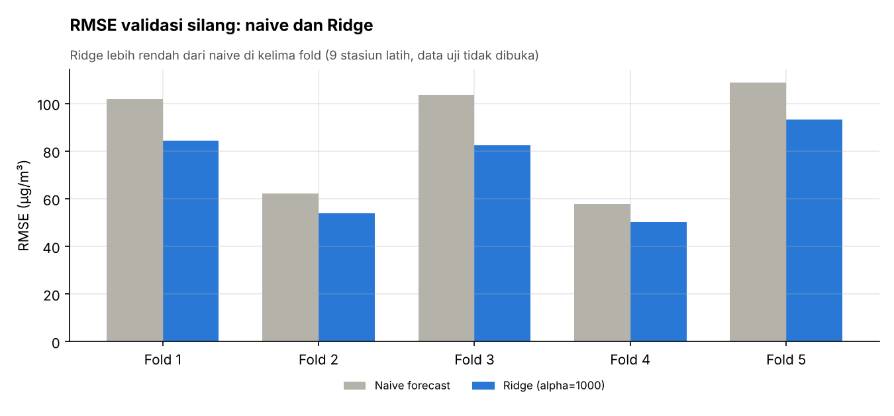
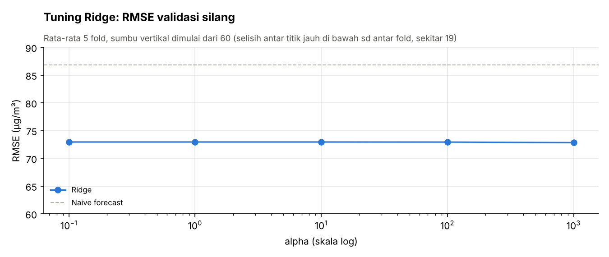
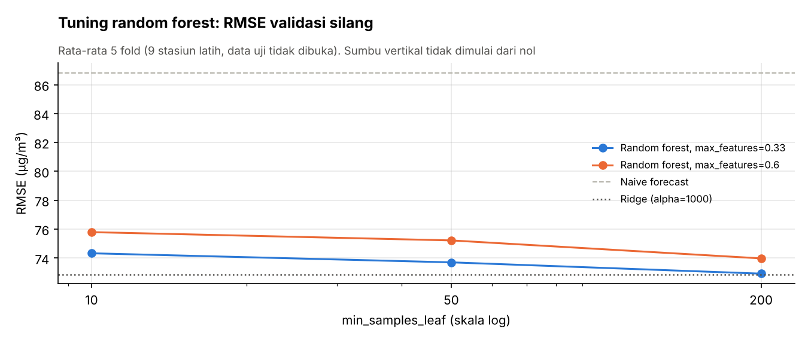
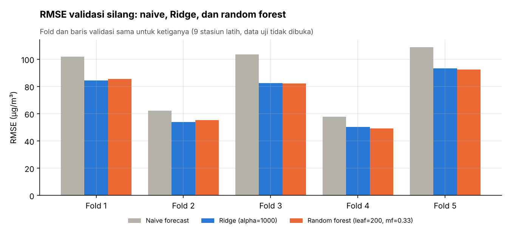

# Ringkasan Hasil Per Tahapan: Peramalan PM2.5 Beijing

Berisi inti hasil tiap tahap, diperbarui setiap satu tahap selesai. Rincian lengkap tahap 1 ada di `Proposal/Proposal Proyek ML PM25 Beijing (Versi Panjang).md`.

| Tahap | Status |
|---|---|
| 1. Proposal dan rumusan masalah | Selesai sebagian (draf selesai, menunggu konfirmasi dosen) |
| 2. EDA dan praproses | Selesai, dijalankan penuh 21 Nov 2026 pada desain 9/3 (lokal dan Colab, angka sama). Angka di bawah memakai data latih 9 stasiun |
| 3. Skema validasi | Desain 9/3 sudah diimplementasikan dan dijalankan 21 Nov 2026 (skema, pengecekan otomatis, alasan, dan keterbatasan ada di *notebook* bagian 03). Penjaga pembukaan data uji ada di bagian 03.3 dan protokol [Usulan, menunggu persetujuan] di `Protokol Evaluasi Data Uji.md`. Penjaga hanya mencegah pembukaan ganda yang tidak disengaja, dan baru teruji saat data uji dibuka. Literatur pendukung: lihat `Proposal/Catatan Verifikasi Referensi.md` (aturan `gap` sama dengan horizon belum punya sumber *peer review* yang terbaca) |
| 4. *Baseline* | Selesai, hasil validasi 9 stasiun latih (dijalankan 21 Nov 2026) |
| 5. Model lanjutan dan *tuning* | Selesai sebagian: model lanjutan Ridge `alpha=1000` (RMSE 72,83 ± 19,38 lawan *naive* 86,82), fitur F1. Pembanding *random forest* (RMSE 72,91 ± 19,40, tidak terbedakan dari Ridge). Belum: pembekuan konfigurasi. Data uji belum dibuka |
| 6. Evaluasi dan diagnosis | Belum dikerjakan |
| 7. Analisis kesalahan dan etika | Belum dikerjakan |

## Revisi desain evaluasi (16 Nov 2026)

Keputusan penulis 16 Nov 2026 menggantikan skema "latih di Tiantan, uji di Dingling" (opsi A) dengan desain berikut. Status: disetujui dosen. Panduan dosen hanya menetapkan uji = 20% periode terakhir dan tantangan "uji model di stasiun lain".

- **Desain:** 9 stasiun latih dan 3 stasiun uji. Waktu 80% awal untuk latih, 20% akhir untuk uji, dengan satu stempel waktu batas untuk semua stasiun. Uji final dibuka satu kali pada 20% akhir dari 12 stasiun, dilaporkan terpisah untuk 9 stasiun latih dan 3 stasiun uji.
- **Porsi baris:** latih 60%, uji 20%, tidak dipakai 20% (80% awal dari 3 stasiun uji, sengaja tidak dipakai agar model belum pernah melihat stasiun itu sebelum diuji).
- **Tiga stasiun uji: Dingling, Wanliu, Shunyi [Keputusan penulis, 16 Nov 2026, ditetapkan sebelum data uji dibuka].** Dasarnya aturan: urutan ke-1, ke-6, dan ke-12 menurut jarak Wasserstein PM2.5 terhadap gabungan 11 stasiun lain, hanya dari data sebelum batas waktu (Dingling paling berbeda, Wanliu sedang, Shunyi paling mirip). *Notebook* 02.2 memeriksa bahwa aturan itu masih menghasilkan daftar yang sama. Mengubahnya berarti mengubah keputusan dan menjalankan ulang semua hasil.
- **Pembagian murni per stasiun pada seluruh periode ditolak:** jam yang sama muncul di data latih dan uji, dan korelasi PM2.5 antar stasiun pada jam yang sama median 0,88, sehingga bocor lewat waktu. Besar kebocoran belum diukur.
- **Syarat teknis:** *fold* dibuat dari stempel waktu unik, `gap` 24 jam dihitung per jam, dan data tidak dipotong menurut urutan stasiun.
- **Pemeriksaan data mentah (16 Nov 2026, dari 12 CSV di repo):** setiap stasiun 35.064 baris, rentang waktu identik, tanpa duplikat waktu. Jumlah PM2.5 kosong berbeda antar stasiun (382 di Wanliu sampai 953 di Huairou, seluruh periode).
- **Dampak:** *notebook* menerapkan desain ini dan dijalankan penuh 21 Nov 2026. Hasil Tahap 2 sampai 4 di bawah dan berkas di `Hasil/Tabel/` (kecuali `t2_tabel_transfer.csv`, sisa pilot) berasal dari jalan itu. Dasar pemilihan Dingling di versi pilot tetap berguna sebagai bahan memilih stasiun uji.
- **Identitas stasiun tidak dipakai sebagai fitur** (ditetapkan 16 Nov 2026, dikukuhkan 21 Nov 2026). Alasannya: tiga stasiun uji tidak pernah muncul di data latih, dan validasi 5 *fold* hanya memakai 9 stasiun latih sehingga tidak bisa menilai manfaat fitur ini untuk stasiun baru. Dampaknya pada akurasi di stasiun latih belum diuji. Desain 9/3 sudah disetujui dosen.

## Tahap 1. Proposal

- **Topik dan *dataset*:** peramalan PM2.5 per jam, regresi deret waktu, Beijing Multi-Site Air Quality (UCI, 12 stasiun, 1 Maret 2013 sampai 28 Februari 2017).
- **Rumusan masalah:** memprediksi PM2.5 pada 24 jam ke depan dari riwayat PM2.5, polutan lain, dan cuaca sampai jam prediksi, sebagai dasar keputusan warga membatasi paparan.
- **Metrik utama:** RMSE, karena galat besar paling merugikan, terutama prediksi terlalu rendah saat konsentrasi tinggi. Pendamping: MAE.
- **Validasi:** data diurutkan menurut waktu, 20% terakhir sebagai data uji (dibuka satu kali), `TimeSeriesSplit` pada 80% awal.
- ***Baseline*:** *naive forecast*. Model lanjutan: Ridge. Pembanding: *random forest* (23 Nov 2026).
- **Tiga tantangan:** nilai hilang (imputasi kausal di dalam *pipeline*), validasi berurutan waktu (tanpa kebocoran), pergeseran distribusi (rencana awal: latih dan validasi di satu stasiun utama, uji di stasiun lain. Diganti 16 Nov 2026 menjadi 9 stasiun latih dan 3 stasiun uji, lihat bagian Revisi desain evaluasi).
- **Keputusan yang sudah ditetapkan:** horizon 24 jam (alasan: waktu bagi warga untuk membatasi paparan), skema uji stasiun lain berupa latih di satu stasiun lalu uji di stasiun lain, nilai ekstrem 999 dipertahankan, stasiun utama Tiantan. Ditambah 15 Nov 2026: stasiun uji Dingling dan tanpa *forward fill* (dasar di tahap 2). Skema uji stasiun lain dan stasiun uji Dingling digantikan desain 9 stasiun latih dan 3 stasiun uji pada 16 Nov 2026.
- **Referensi:** [1] Cui dkk. 2023; [2] Hewamalage dkk. 2023; [3] Hua dkk. 2024; [4] Kapoor dan Narayanan 2023; [5] Lones 2024 (detail dan status verifikasi ada di `Proposal/Catatan Verifikasi Referensi.md`).

## Tahap 2. EDA dan praproses

Semua angka berasal dari eksekusi `Notebook/Tahap 2 EDA dan Praproses.ipynb` pada 9 stasiun latih dan **hanya memakai data latih**, kecuali disebut lain. *Notebook* dijalankan penuh 21 Nov 2026 di lingkungan lokal dan di Colab, tanpa *error*. Angka sama, kecuali analisis HGB di 04.6 yang bergeser kecil antar lingkungan (lihat di bawah).

Keluaran *notebook*: sembilan grafik di `Hasil/Gambar/`, enam tabel di `Hasil/Tabel/` (dua EDA, tiga dasar keputusan, satu *baseline*; `t2_tabel_transfer.csv` adalah sisa pilot), dan fitur siap pakai (latih dan uji) di `Data/Data Olahan/` (tidak ikut di repo, dibuat dengan menjalankan *notebook*). Berkas fitur uji hanya disimpan, tidak dibuka untuk analisis.

- **Pembagian waktu:** data uji dimulai 2016-05-12 19:00 (20% jam terakhir), disisihkan sebelum eksplorasi dan tidak dibuka. Data latih seluruh stasiun 336.612 baris (80%).
- **Sebaran PM2.5:** median 57, rata-rata 81,1, miring ke kanan (*skewness* 1,95). Galat besar saat episode polusi tinggi akan mendominasi RMSE.
- **Nilai ekstrem (9 stasiun latih, data latih):** 531 jam-stasiun di atas 500, 23 di atas 700, 1 di atas 900, 1 bernilai tepat 999. Pada 17 jam dengan PM2.5 di atas 700 di suatu stasiun, median 7 dari 9 stasiun ikut di atas 300, jadi lonjakan itu terjadi serempak dan sejalan dengan keputusan mempertahankan nilai ekstrem. Belum ada bukti batas alat ukur.
- **Pola waktu:** rata-rata tertinggi bulan Desember (99), terendah Agustus (57). Per jam, tertinggi pukul 21.00 (90), terendah pukul 16.00 (75).
- **Nilai hilang PM2.5:** 2,16% pada data latih 9 stasiun, dalam 1.730 rentang nilai hilang berturut-turut. Median rentang 1 jam, terpanjang 343 jam, dan 22 rentang lebih dari 24 jam. Rentang sampai 3 jam mencakup 87% dari seluruh rentang tetapi hanya 39% jam yang hilang.
- **Korelasi dengan PM2.5 24 jam kemudian:** PM2.5 sekarang 0,40, NO2 0,35, CO 0,34, PM10 0,34. Korelasi PM2.5 dengan nilai sebelumnya turun dari 0,40 (24 jam) ke 0,14 (48 jam) dan 0,05 (72 jam), sehingga *lag* lebih dari dua hari hampir tidak informatif.
- **Antarstasiun (rata-rata PM2.5 data latih):** Dingling 67,0, Huairou 71,0, Tiantan 82,2, Dongsi 85,7. Rata-rata yang berbeda belum membuktikan stasiun itu paling sulit diprediksi (lihat bagian stasiun uji di bawah).
- **Fitur dan target:** target PM2.5 pada jam t+24, 29 fitur yang hanya memakai data sampai jam t (kondisi sekarang, *lag* 1 sampai 48 jam, *rolling mean* 6, 24, 72 jam, kalender, arah angin). Baris latih 246.798 (9 stasiun), baris uji 82.151 (61.686 dari stasiun latih dan 20.465 dari stasiun uji; disimpan, tidak dibuka).
- **Penutupan celah kebocoran:** baris latih yang targetnya jatuh di periode uji (24 jam terakhir) dibuang.
- **Nilai hilang pada fitur (keputusan 15 Nov 2026: tanpa *forward fill*):** target yang hilang dibuang, fitur hilang diisi median di dalam *pipeline* per *fold*. Interpolasi tidak dipakai karena melihat nilai sesudahnya. Pada berkas latih, 23 dari 29 fitur masih punya sel kosong, tertinggi `CO` 4,88%.
- **Dasar keputusan *forward fill*:** pengisian 0, 1, 3, 6, 12, dan 24 jam dibandingkan pada 5 *fold* data latih 9 stasiun (`TimeSeriesSplit(gap=24)`, Ridge dan `HistGradientBoostingRegressor`). Ridge: RMSE 73,16 sampai 73,23 (beda maksimum 0,07). HGB: 76,93 sampai 77,55 (beda maksimum 0,62), dengan rentang RMSE antar *seed* pada pengaturan yang sama 0,87 di lingkungan lokal dan 0,55 di Colab (beda maksimum antar pengaturan di Colab 0,96). Simpangan baku antar *fold* sekitar 19,7 (Ridge) dan 22 (HGB). Tidak ada beda yang bisa dibedakan dari *noise*, jadi dipilih yang paling sederhana (tanpa *forward fill*). Analisis ini ada di *notebook* bagian 04.6 (tabel `Hasil/Tabel/t2_tabel_ffill.csv`, dari jalan lokal). HGB bergeser sekitar 0,5 sampai 1 poin antar lingkungan, jadi selisih RMSE antar model di bawah itu tidak boleh diklaim.
- **Stasiun uji: Dingling, Wanliu, Shunyi (ditetapkan 16 Nov 2026).** Dasarnya jarak Wasserstein PM2.5 terhadap gabungan 11 stasiun lain, hanya dari data sebelum batas waktu: Dingling 14,4 (urutan 1, rata-rata 67,0), Wanliu 5,0 (urutan 6), Shunyi 0,9 (urutan 12). Pada versi pilot (latih di Tiantan, validasi di stasiun lain), biaya transfer semua stasiun kecil dan Dingling **tidak terbukti paling sulit**, jadi hasil di data uji nanti dilaporkan apa adanya. Perhitungan pilot itu ada di riwayat git (bagian 04.7 sebelum 16 Nov 2026), dan `t2_tabel_transfer.csv` adalah sisa pilot.
- **Belum dikerjakan:** penamaan *notebook* akhir (`D082261018_Muhammad Alif Qadri_ProyekML.ipynb`).

## Tahap 3. Skema validasi

- **Pembagian:** uji = 20% jam terakhir (mulai 2016-05-12 19:00, dibuka satu kali di akhir), tanpa diacak. Pemilihan model dan *tuning* memakai `TimeSeriesSplit(n_splits=5, gap=24)` pada data latih.
- ***Gap* 24 jam (`gap=24`):** target sebuah baris adalah PM2.5 24 jam sesudahnya. Tanpa *gap*, target baris latih terakhir pada tiap *fold* jatuh di periode validasi, padahal nilai itu juga muncul sebagai fitur *lag* di data validasi. Kebocoran ini ditemukan 15 Nov 2026 saat pemeriksaan ulang dan ditutup. Pengecekannya ada di *notebook* (`assert` di bagian 03 dan 04.5).
- **Alasan tiap pilihan** (rinci di *notebook* 03.1): data berurutan waktu sehingga tidak boleh diacak, jendela latih melebar meniru pemakaian nyata, 5 *fold* mengikuti contoh panduan dan bergantian mencakup musim dingin (*fold* 1, 3, 5) dan musim hangat (*fold* 2, 4), dan data uji dibuka satu kali. *Notebook* juga memuat tabel risiko kebocoran beserta penjagaannya.
- **Keterbatasan** (rinci di *notebook* 03.2): lima *fold* sedikit dan simpangan baku RMSE antar *fold* besar, periode uji hanya sekitar 9,5 bulan (tanpa Maret sampai awal Mei), hanya satu pembagian uji, uji stasiun lain memakai periode yang sama dengan uji utama, dan penyebab perbedaan skor antar *fold* belum diuji.
- **Keterbukaan:** statistik ringkas periode uji pernah terlihat (profil awal 7 Nov di dokumen konteks, dan ringkasan berkas fitur uji saat pemeriksaan 15 Nov). Tidak dipakai untuk memilih fitur, model, atau pengaturan, tetapi perlu diakui di bagian keterbatasan laporan.
- **Lima *fold*:** validasi berturut-turut 2013-09-11 sampai 2014-03-25, 2014-03-25 sampai 2014-10-05, 2014-10-05 sampai 2015-04-18, 2015-04-18 sampai 2015-10-30, dan 2015-10-30 sampai 2016-05-11. Tiap *fold* melatih dengan masa lalu dan memvalidasi dengan periode sesudahnya.

## Tahap 4. *Baseline*

Validasi 5 *fold* pada data latih 9 stasiun, tanpa menyentuh data uji. Baris validasi yang PM2.5 jam *t*-nya kosong (3.625 dari 205.459) dibuang karena *naive forecast* tidak bisa memprediksi tanpa nilai itu.

| Model | RMSE rata-rata ± sd | MAE rata-rata ± sd |
|---|---|---|
| *Naive forecast* (PM2.5 jam *t+24* = PM2.5 jam *t*) | 86,82 ± 24,70 | 59,39 ± 16,53 |

- RMSE per *fold* (101,7 / 62,2 / 103,6 / 57,7 / 108,8) naik turun mengikuti periode (*fold* 1, 3, dan 5 lebih tinggi), jadi simpangan baku yang besar kemungkinan berasal dari beda periode antar *fold* (belum diuji penyebabnya).
- Ini hasil validasi data latih, bukan data uji. Skor uji dibuka satu kali di akhir.

## Tahap 5. Model lanjutan, pembanding, dan *tuning* (22 sampai 24 Nov 2026)

### Dua model yang dipakai

**Ridge** adalah regresi linear dengan penalti pada besar koefisien (regularisasi L2). Parameter `alpha` mengatur kekuatan penalti: makin besar, koefisien makin ditekan sehingga model lebih stabil terhadap fitur yang saling berkorelasi, seperti *lag* PM2.5 yang berdekatan. Prediksinya berupa jumlah berbobot dari 29 fitur, jadi mudah dijelaskan dan cepat dilatih.

***Random forest* (RF)** adalah kumpulan banyak pohon keputusan, masing-masing dilatih pada contoh dan fitur yang diacak, lalu prediksinya dirata-ratakan. RF dapat menangkap hubungan nonlinear dan interaksi antar fitur tanpa diminta, tetapi prediksinya tidak bisa melampaui rentang nilai target yang pernah dilihat saat pelatihan.

### Mengapa keduanya, dan apa yang dibandingkan

Target proyek adalah PM2.5 24 jam ke depan pada deret waktu per jam. Pemilihan model mengikuti sifat data tersebut, sebagai dugaan yang diuji oleh perbandingan di bawah, bukan sebagai hasil yang sudah terbukti.

* **Ridge.** PM2.5 sangat bergantung pada nilainya sendiri beberapa jam dan hari sebelumnya, dan *naive forecast* yang hanya memakai nilai jam t sudah memberi patokan RMSE 86,82. Hubungan antara PM2.5 pada t+24 dan fitur *lag* serta rata-rata bergulir kemungkinan besar dekat dengan linear. Fitur-fitur itu juga saling berkorelasi kuat (*lag* 1, 2, 3, rata-rata 6 jam, rata-rata 24 jam), dan penalti L2 pada Ridge dirancang untuk menstabilkan koefisien pada kondisi ini. Ridge karenanya menjadi model terlatih yang paling relevan dengan struktur fitur proyek ini.
* ***Random forest*.** Proses fisik yang membentuk PM2.5 tidak linear: angin kencang membersihkan polutan hanya di atas ambang tertentu, efek arah angin bergantung pada kelembapan dan suhu, dan polutan menumpuk saat angin lemah. Pohon menangkap ambang dan interaksi seperti ini tanpa direkayasa lebih dulu. RF juga relevan dengan tantangan pergeseran distribusi: prediksi pohon dibatasi oleh rentang target di data latih, sedangkan model linear dapat mengekstrapolasi, sehingga keduanya bisa berperilaku berbeda di stasiun uji yang konsentrasinya bergeser.
* **Yang dibandingkan.** Apakah hubungan nonlinear memberi keuntungan dibanding model linear pada horizon 24 jam. RF tidak harus lebih baik, dan hasil seri atau kalah tetap menjadi bahan evaluasi.
* **Perlakuan dibuat sama:** fitur F1 (29 fitur awal), objek *fold* yang sama (`TimeSeriesSplit(n_splits=5, gap=24)` pada jam unik data latih 9 stasiun), baris validasi sama dengan *naive*, imputer median dan *scaler* hanya belajar dari data latih tiap *fold*. **Data uji tidak dibuka.**

### *Tuning*

*Grid* dan aturan pemilihan ditulis sebelum hasil dilihat, dan *grid* tidak diperluas setelahnya. Pemilihan memakai RMSE rata-rata 5 *fold* terendah.

| Model | Hiperparameter yang disetel | Nilai yang dicoba | Konfigurasi |
|---|---|---|---|
| Ridge | `alpha` | 0,1; 1; 10; 100; 1000 | 5 |
| *Random forest* | `min_samples_leaf` dan `max_features` | 10; 50; 200 dan 0,33; 0,6 | 6 |

Parameter RF yang dikunci: `n_estimators=100`, `max_depth=None`, `max_samples=0,5`, `bootstrap=True`, `random_state=42`. Terpilih Ridge `alpha=1000` dan RF `min_samples_leaf=200`, `max_features=0,33`.

### Hasil

| Model | RMSE rata-rata ± sd | MAE rata-rata ± sd | Perbaikan RMSE vs *naive* | *Fold* lebih baik dari *naive* |
|---|---|---|---|---|
| *Naive forecast* | 86,82 ± 24,70 | 59,39 ± 16,53 | n/a | n/a |
| Ridge `alpha=1000` | 72,83 ± 19,38 | 54,51 ± 13,00 | 16,1% | 5 dari 5 |
| *Random forest* (`min_samples_leaf=200`, `max_features=0,33`) | 72,91 ± 19,40 | 54,38 ± 13,32 | 16,0% | 5 dari 5 |

* **Keduanya mengalahkan *naive* di kelima *fold*.** RMSE turun sekitar 14 (sekitar 16%) dan MAE turun sekitar 5 (sekitar 8%).
* **Ridge dan RF tidak terbedakan.** Selisih RMSE berpasangan (RF dikurangi Ridge) rata-rata 0,08 dengan sd 1,15, dan RF lebih baik di 3 dari 5 *fold*. Rentang RMSE antar *seed* RF (42 sampai 45) hanya 0,09. Tidak ada klaim bahwa salah satunya lebih baik.
* **Kurva *tuning* datar.** Ridge: RMSE 72,94 pada `alpha` 0,1 sampai 10, 72,93 pada 100, 72,83 pada 1000. RF: 72,91 sampai 75,79 antar konfigurasi, turun saat `min_samples_leaf` membesar dan `max_features` mengecil.
* **Keterbatasan.** Optimum Ridge (`alpha=1000`) dan RF (`min_samples_leaf=200`, `max_features=0,33`) berada di tepi *grid*, sehingga belum tentu yang terbaik. Konfigurasi dipilih pada lima *fold* yang sama, sehingga skornya optimistis. Eksperimen lama 22 Nov yang memuat RF pernah dilihat, jadi *tuning* RF tidak sepenuhnya buta. Konfigurasi belum dibekukan dan data uji belum dibuka.

Rincian lengkap: `Laporan/Tabel Hasil Percobaan Tahap 5.md` (tabel 14 konfigurasi) dan berkas CSV di `Hasil/Tabel/` (`t5_tabel_*`).
