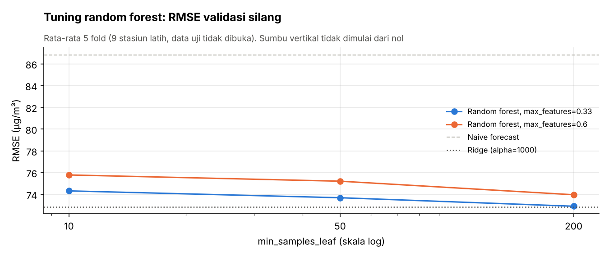
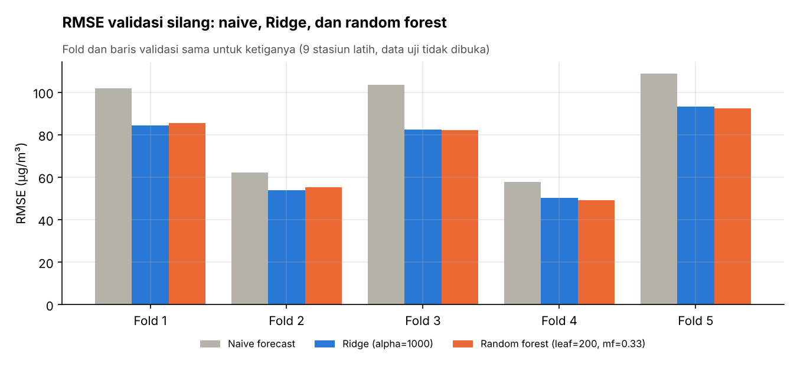

# Tabel Hasil Percobaan Tahap 5

Hasil validasi silang `TimeSeriesSplit(n_splits=5, gap=24)` pada data latih 9 stasiun, urut dari RMSE rata-rata terendah. Semua konfigurasi dilatih langsung pada 9 stasiun dengan *fold*, baris validasi, dan praproses per *fold* yang sama dengan *naive forecast*. **Data uji tidak dibuka.** Model lanjutan yang dipakai di Tahap 5 ditebalkan. Tuning pembanding *random forest* ada di bagian terakhir berkas ini.

## Tabel (8 konfigurasi)

| No | Konfigurasi | Fitur | RMSE | sd RMSE | MAE | Perbaikan vs *naive* (%) | *Fold* lebih baik dari *naive* |
|---|---|---|---|---|---|---|---|
| 1 | **Ridge (alpha=1000), model lanjutan** | F1 (29 fitur awal) | 72,83 | 19,38 | 54,52 | 16,1 | 5 dari 5 |
| 2 | Ridge | F1 + cuaca dinamis | 72,85 | 19,27 | 54,50 | 16,1 | 5 dari 5 |
| 3 | Ridge (alpha=100) | F1 (29 fitur awal) | 72,93 | 19,39 | 54,57 | 16,0 | 5 dari 5 |
| 4 | Ridge (alpha=10) | F1 (29 fitur awal) | 72,94 | 19,39 | 54,58 | 16,0 | 5 dari 5 |
| 5 | Ridge (alpha=1) | F1 (29 fitur awal) | 72,94 | 19,39 | 54,58 | 16,0 | 5 dari 5 |
| 6 | Ridge (alpha=0,1) | F1 (29 fitur awal) | 72,94 | 19,39 | 54,58 | 16,0 | 5 dari 5 |
| 7 | Ridge | F1 + statistik PM dan polutan | 72,98 | 19,65 | 54,50 | 15,9 | 5 dari 5 |
| 8 | *Naive forecast* |  | 86,82 | 24,70 | 59,39 | 0,0 | 0 dari 5 |

## Cara membaca

* **RMSE** dan **MAE** adalah rata-rata 5 *fold* (µg/m³, makin kecil makin baik). **sd RMSE** adalah simpangan baku antar *fold*, yaitu sebaran kesulitan antar periode. Perbaikan dihitung terhadap RMSE *naive forecast* 86,82.
* Selisih antar konfigurasi Ridge jauh di bawah sd RMSE (sekitar 19), jadi urutan **tidak berarti** peringkat yang berdekatan berbeda nyata.
* Skor dipilih dari beberapa konfigurasi pada lima *fold* yang sama, sehingga optimistis dan bukan kinerja akhir. Kinerja akhir hanya dari data uji, satu kali.
* Dua baris dengan fitur tambahan (cuaca dinamis, statistik PM dan polutan) berasal dari percobaan lama. Kodenya tidak ada lagi di *notebook*, tetapi ada di riwayat Git.
* Nilai tiap *fold* ada di `Hasil/Tabel/t5_tabel_semua_eksperimen.csv`.

## Tuning *random forest* (pembanding Ridge, 23 Nov 2026)

Keputusan penulis (23 Nov 2026): pembanding Ridge adalah *random forest* (RF). Pertanyaan yang dijawab, ditulis sebelum hasil dilihat: apakah model nonlinear berbasis pohon memberi keuntungan dibanding model linear berregularisasi pada horizon 24 jam. RF tidak harus lebih baik. Perlakuannya sama dengan Ridge: fitur F1 (29 fitur awal), objek *fold* yang sama (`TimeSeriesSplit(n_splits=5, gap=24)` pada jam unik 9 stasiun latih), imputer median dan *scaler* dilatih ulang per *fold* hanya dari data latih *fold* itu, baris validasi sama dengan *naive forecast*, RMSE utama dan MAE pendamping. **Data uji tidak dibuka.**

*Grid* ditetapkan sebelum dijalankan dan tidak diubah: `min_samples_leaf` 10; 50; 200 dan `max_features` 0,33; 0,6 (6 konfigurasi). Dikunci: `n_estimators=100`, `max_depth=None`, `max_samples=0,5`, `bootstrap=True`, `random_state=42`. Aturan pemilihan: RMSE rata-rata terendah, tepi *grid* dilaporkan, *grid* tidak diperluas.

### Tabel *tuning* RF (6 konfigurasi)

| No | Konfigurasi | Fitur | RMSE | sd RMSE | MAE | Perbaikan vs *naive* (%) | *Fold* lebih baik dari *naive* |
|---|---|---|---|---|---|---|---|
| 1 | ***Random forest* (`min_samples_leaf=200`, `max_features=0,33`), pembanding** | F1 (29 fitur awal) | 72,91 | 19,39 | 54,38 | 16,0 | 5 dari 5 |
| 2 | *Random forest* (`min_samples_leaf=50`, `max_features=0,33`) | F1 (29 fitur awal) | 73,69 | 19,76 | 54,66 | 15,1 | 5 dari 5 |
| 3 | *Random forest* (`min_samples_leaf=200`, `max_features=0,60`) | F1 (29 fitur awal) | 73,97 | 19,46 | 54,98 | 14,8 | 5 dari 5 |
| 4 | *Random forest* (`min_samples_leaf=10`, `max_features=0,33`) | F1 (29 fitur awal) | 74,32 | 19,73 | 54,99 | 14,4 | 5 dari 5 |
| 5 | *Random forest* (`min_samples_leaf=50`, `max_features=0,60`) | F1 (29 fitur awal) | 75,21 | 19,86 | 55,52 | 13,4 | 5 dari 5 |
| 6 | *Random forest* (`min_samples_leaf=10`, `max_features=0,60`) | F1 (29 fitur awal) | 75,79 | 19,78 | 55,91 | 12,7 | 5 dari 5 |

### Naive, Ridge, dan RF pada *fold* yang sama

| Model | RMSE rata-rata ± sd | MAE rata-rata ± sd | Perbaikan RMSE vs *naive* (%) | *Fold* lebih baik dari *naive* |
|---|---|---|---|---|
| *Naive forecast* | 86,82 ± 24,70 | 59,39 ± 16,53 | 0,0 | 0 dari 5 |
| Ridge (`alpha=1000`) | 72,83 ± 19,38 | 54,51 ± 13,00 | 16,1 | 5 dari 5 |
| *Random forest* (`min_samples_leaf=200`, `max_features=0,33`) | 72,91 ± 19,40 | 54,38 ± 13,32 | 16,0 | 5 dari 5 |

RMSE tiap *fold* (1 sampai 5): *naive* 101,7 / 62,2 / 103,6 / 57,7 / 108,8; Ridge 84,3 / 54,0 / 82,4 / 50,3 / 93,2; RF 85,5 / 55,3 / 82,2 / 49,1 / 92,4.

### Cara membaca hasil RF

* **RF dan Ridge tidak terbedakan.** Selisih RMSE berpasangan (RF dikurangi Ridge) rata-rata 0,08 dengan sd selisih 1,15. Per *fold*: 1,21; 1,35; -0,23; -1,20; -0,73, jadi RF lebih baik di 3 dari 5 *fold*. Selisih MAE rata-rata (RF dikurangi Ridge) -0,13. Tidak ada klaim bahwa salah satunya lebih baik.
* **Kepekaan *seed*.** Konfigurasi terpilih dilatih ulang dengan *seed* 42; 43; 44; 45: RMSE rata-rata 72,91; 72,93; 72,92; 73,00. Rentang antar *seed* 0,09, jauh di bawah sd selisih antar *fold*.
* **Optimum RF ada di tepi *grid* pada kedua hiperparameter.** RMSE turun konsisten saat `min_samples_leaf` membesar dan `max_features` mengecil. RF yang lebih teregularisasi mungkin sedikit lebih baik. Sesuai aturan, *grid* tidak diperluas, jadi RF terpilih belum tentu RF terbaik untuk data ini.
* **Keterbukaan.** Pada 22 Nov 2026 pernah dijalankan eksperimen lanjutan yang memuat RF (sekitar 85 konfigurasi, lalu dihapus dari repositori atas permintaan penulis). *Grid* di atas disusun tanpa memakai hasil itu, tetapi percobaan lama pernah dilihat, sehingga *tuning* ini tidak sepenuhnya buta dan skornya optimistis.
* **Perbedaan jumlah hiperparameter.** Ridge menyetel satu hiperparameter (5 nilai), RF dua (6 konfigurasi). Model yang lebih fleksibel punya peluang lebih besar mendapat skor optimistis dari pemilihan pada *fold* yang sama.
* **Galat menurut rentang konsentrasi** (prediksi seluruh *fold* validasi digabung, `Hasil/Tabel/t5_tabel_galat_rentang.csv`): pada PM2.5 sebenarnya di atas 250 µg/m³, bias Ridge -200,0 dan RF -200,0, RMSE Ridge 216,7 dan RF 218,0, lebih besar dari *naive* (171,6). Keduanya memprediksi terlalu rendah saat polusi sangat tinggi. Sebagian pola ini adalah efek pengelompokan menurut nilai sebenarnya (regresi ke rata-rata), jadi yang dibandingkan adalah selisih antar model, bukan tanda bias.
* Skor dipilih dari beberapa konfigurasi pada lima *fold* yang sama, sehingga optimistis dan bukan kinerja akhir. Kinerja akhir hanya dari data uji, satu kali.
* Nilai tiap *fold* ada di `Hasil/Tabel/t5_tabel_tuning_rf_per_fold.csv` dan `t5_tabel_rf_vs_ridge_per_fold.csv`. Rincian dan *seed* di `t5_tabel_tuning_rf.csv`, `t5_tabel_rf_vs_ridge.csv`, dan `t5_tabel_rf_seed.csv`. Bagian *notebook*: 05.3 sampai 05.7.

